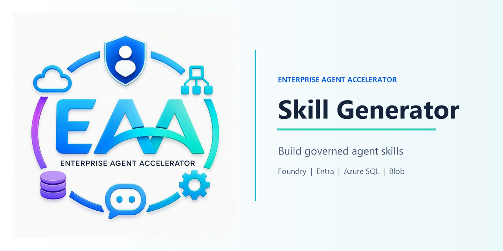

# Foundry Skill Generator Using Chat

對話式 Skill 產生器（FastAPI + 原生 JavaScript），最終產出物為一份 `SKILL.md`（script 型另附一支 `scripts/<name>.py`；也可附帶使用者上傳的 `assets/`、`references/` 檔案）。
本專案為**本機執行**的解決方案，串接 Microsoft Foundry、Microsoft Entra、Azure SQL 與 Azure Blob。

## 重大變更 (What's New) 2026-10

### Manage Skills 管理面板

從頁面右上方的 **Manage Skills**，或儲存後對話中的同名入口，即可管理**自己建立的全域 Skill**，包含已停用項目；不需先開啟對話，也不必等到 DONE 階段。此面板管理使用權與刪除，內容修改仍使用 Generator 的 MODIFY 流程。

| 項目 | 功能 |
| --- | --- |
| **使用權管理** | 搜尋 Azure SQL 已登錄的使用者／應用程式身分與安全群組，新增或移除授權；每次操作成功即生效，不需另按儲存。 |
| **公開設定** | 切換 Public，讓所有具備 EAA 存取資格的使用者使用 Skill；改回私人時保留原有授權。公開不代表匿名存取，也不授予修改或管理權。 |
| **相依關係** | 以 Depends On / Used By 查看依賴與引用路徑；被引用時阻擋刪除，可透過 Open scenario 進入修改流程，或聯絡引用者的建立者。無權查看的引用不公開名稱。 |
| **安全刪除** | 須完成相依檢查、輸入完整 Skill 名稱並確認，且成功備份最後版本後才執行刪除。刪除 scenario 時，可選擇將失去最後引用的內部子 Skill 顯示為獨立 capability，或保留 internal；不會連帶刪除子 Skill。 |

他人公開或授權給你的 Skill，以及私人命名空間 Skill，不列入可管理清單。刪除會移除正式套件、SQL 登錄與存取授權，但保留歷史備份及對話；綁定的對話會顯示 **Skill deleted**，不能再直接儲存至該 Skill。備份前提見下方「Skill 覆寫與刪除前備份」，完整操作與畫面見 [Manage Skills 圖文指南](docs/06-manage-skills-guide.md)。

### Skill 覆寫與刪除前備份

啟用後，Generator 每次覆寫既有 skill 前，會先將 Blob 上的舊 `SKILL.md`、script 與所有附帶檔案保存到獨立歷史容器，再執行正常儲存。每份備份附有 `manifest.json`，記錄來源版本、備份觸發者與時間，以及各檔案的 SHA256；首次建立不備份，NEW session 再次儲存與鄰近 skill 儲存也適用。

**啟用方式**：在同一 Storage Account 預先建立獨立、非匿名的歷史容器（例如 `skill-history`），授予 Generator 使用的 Blob 身分所需讀寫權限，設定 `AZURE_BLOB_HISTORY_CONTAINER` 後重新啟動。留空不啟用覆寫備份，也無法使用 Manage Skills 的刪除功能；備份失敗會回 HTTP 503 並停止覆寫或刪除，覆寫版本衝突仍回 409。

**功能範圍**：Manage Skills 刪除前必須成功備份最後版本的完整套件，備份標記為 `operation: delete`；完成後重新檢查相依關係與來源版本，才刪除正式檔案與 SQL 登錄。歷史不自動清理，刪除或改名也不移除已有備份；改名不額外建立備份，目前不提供歷史清單、差異比較或還原介面。備份不保證跨檔案原子一致性，亦非所有外部寫入的完整稽核紀錄。

容器與權限設定見 [02-setup.md 第 2.5 節](docs/02-setup.md#25-azure-blob)，備份格式與儲存流程見 [03-architecture.md 第 2.2 節](docs/03-architecture.md#22-儲存接受-patch--按下儲存)。

### Inline ↔ Script 形式轉換

開啟既有 capability skill 的 **MODIFY session**，即可用 **Convert to script / inline** 將程式碼在 `SKILL.md` 的 Python 區塊與 `scripts/<name>.py` 之間搬移。quick edit 與 re-plan 都支援；入口位於對話區上方、Workflow 狀態列及 Checklist 的 Convert form 區塊。

轉換只搬程式碼，不改寫 `SKILL.md`；後續由 Agent 配合新形式修正文案與章節。inline → script 時，若 session 沒有 `code` 素材，會加入一份與 script 相同的素材，讓 Agent 在 PREPARE / REFINE 提出使用者審閱的邊界 patch（命令列參數、JSON stdout、`[NEEDS_INFO]`、stderr、exit code），不改動外部呼叫、認證或業務邏輯。接受後仍需使用者實際執行確認。

> ⚠️ **轉換條件**：session 尚無 patch；inline → script 要求正文（不含 Gatekeeper Addendum）剛好一個可解析的 Python 區塊、沒有 skill 資產，且 EAA script 旗標已開啟。搬移不代表通過 lint，儲存仍須通過本機與 EAA 檢查。轉換本身不寫 Blob，但接受後續 `SKILL.md` patch 時會嘗試同步 Blob / SQL；script → inline 儲存成功時會移除原 script 檔案。

詳細規則見 [04-agent-mechanism.md 第 7.5 節](docs/04-agent-mechanism.md#75-code-素材與-script-形式)。

### Skill 資產

在 Materials 分頁的 Skill assets 區塊上傳 UTF-8 文字檔，存檔時原封不動寫到 `skills/<name>/assets/` 或 `references/`；scenario 與 script 型 skill 不可附資產。檢查規則與資料流見 [04-agent-mechanism.md 第 7.6 節](docs/04-agent-mechanism.md#76-skill-資產assetsreferences)。

> ⚠️ **存檔條件**：附有資產的 skill，`SKILL.md` 必須以完整路徑（例如 `` `assets/style.css` ``）列出每個檔案，且不得提到未附加的路徑；否則無法儲存。MODIFY 時若 Blob 上有不合規的檔案（二進位檔、子目錄、超過上限），會拒絕建立 session 並列出原因。

### Script 型 skill

使用者附上**唯一一份** Python `code` 素材、確認它涵蓋所有操作，且目標 EAA 已開啟 script 執行時，產出物改為 `SKILL.md` 加上**原樣**出貨的 `scripts/<name>.py`；其他情況維持原本的 inline 形式。

> ⚠️ **使用前提**：目標 EAA 的 `DYNAMIC_SKILLS_ENABLED` 與 `SKILL_SCRIPTS_ENABLED` 皆為 `true`，且 `lint_skill_package` 的 ruleset ≥ 1.1；否則只會產出 inline 型。

| 項目 | 變更 | 詳細說明 |
| --- | --- | --- |
| **產出形式** | NEW 依素材與 EAA 旗標自動判斷，進 DRAFT 後鎖定；MODIFY 可用 Convert form 互轉（見上方）。script 透過 `code` 素材取代，Agent 僅在符合條件時調整素材邊界，不改寫業務邏輯。 | [04-agent-mechanism.md](docs/04-agent-mechanism.md#75-code-素材與-script-形式) |
| **檢查** | script 須通過專屬 lint（S 系列：stdout 只輸出 JSON、`[NEEDS_INFO]` 以 exit 0 結束等），並與 `SKILL.md` 一起送 EAA lint。 | [04-agent-mechanism.md](docs/04-agent-mechanism.md#75-code-素材與-script-形式) |
| **儲存** | script 型每次儲存都重新確認 EAA 旗標。**所有 skill** 覆寫時都會比對 Blob 版本，載入後被改過（例如 Gatekeeper Addendum）就回 409，不會覆蓋。 | [04-agent-mechanism.md](docs/04-agent-mechanism.md#eaa-script-旗標)、[03-architecture.md](docs/03-architecture.md) |
| **介面** | Materials、Checklist（Output form）、Files 分頁（`SKILL.md \| scripts/<name>.py`）與 Skill 清單（`[script]`）顯示目前形式與未滿足的條件。 | [01-overview.md](docs/01-overview.md) |

### 安全性調整

配合 EAA 上線的安全性調整：`/run` 驗證 Bearer token、skill 執行環境過濾、腳本改以隔離 uid 執行，以及 Managed Identity 閘門（S3）。

> ⚠️ **升級必做**：`.env` 必須設定 `MCP_ENDPOINT`（例如 `https://eaa.foundryeaa.org/mcp`），且該 EAA 已部署 MCP tool `lint_skill_package`；否則**無法儲存 skill**。不再需要 `EAA_REPO_DIR`，本機也不需要 EAA repo，可以從 `.env` 移除。

| 項目 | 變更 | 詳細說明 |
| --- | --- | --- |
| **路由測試呼叫方式** | 使用者 token 只放在 `Authorization` header，body `credentials` 不再帶 token。收到 HTTP 401 時整批中止並回 502。 | [04-agent-mechanism.md](docs/04-agent-mechanism.md#34-testrouter-endpoint-路由盲測)（Runtime `/run` 契約） |
| **Managed Identity** | 使用 `DefaultAzureCredential()` 的 skill 必須在 frontmatter 宣告 `metadata.mi_scopes`，只列實際用到的資源；Key Vault 一律禁止。不在平台 `MI_SCOPE_ALLOWLIST` 的資源不擋存檔，但 Agent 會附上部署說明。 | [04-agent-mechanism.md](docs/04-agent-mechanism.md)（EAA 平台規則）、[10_format_spec.md](prompts/10_format_spec.md)（The Managed Identity Contract） |
| **SKILL.md 生成規則** | 禁止讀取 3 個平台 secret；caller 的 `credentials` 鍵名不得使用 EAA 保留名稱；MI token 只能經 azure-identity 取得。對應 lint 規則 D4–D8、A15。 | [04-agent-mechanism.md](docs/04-agent-mechanism.md)（EAA 平台規則） |
| **執行環境規則** | 範例程式碼只能讀寫工作目錄、不在執行時安裝套件、不依賴使用者帳號資訊、不留背景行程（E1–E5）。E2–E4 **會擋存檔**，E1 只警告。 | [04-agent-mechanism.md](docs/04-agent-mechanism.md)（EAA 執行環境規則） |
| **儲存前檢查** | 先跑本機 lint，再呼叫 EAA 的 `lint_skill_package`：有 error 就擋下，warnings 由 Agent 轉述、不擋；取不到判定一律 fail-closed（503）。 | [03-architecture.md](docs/03-architecture.md#23-eaa-skill-lint) |

> TEST 若要反映 EAA 正式環境，請維運在 `/run` 所打的 EAA 環境設定 `SUBPROCESS_UID_SANDBOX=true`（EAA 端 ACA 環境變數，本專案不需設定）。

## 文件導覽

依閱讀需求選擇下列文件；一般作者可先看 Generator 完整使用者指南：

| 文件 | 內容 |
| --- | --- |
| [docs/01-overview.md](docs/01-overview.md) | **專案介紹**：這個專案在做什麼、使用者是誰、有什麼需求、核心功能、使用者流程圖。 |
| [docs/02-setup.md](docs/02-setup.md) | **啟動與設定**：需要哪些服務、環境變數完整清單、SQL / Blob / Entra 設定、啟動與登入步驟。 |
| [docs/03-architecture.md](docs/03-architecture.md) | **程式碼與架構**：整體架構圖、資料流、前端 / 後端 / 資料庫細節、每個檔案的職責，以及登入與 Token 流程。 |
| [docs/04-agent-mechanism.md](docs/04-agent-mechanism.md) | **Agent 機制**：五個 state 的 Input / Prompt / Output、品質關卡 checklist、state 轉換、Agent 工具清單、提示詞對照、素材（Materials）三層可信度合約與 Agent Graph 使用方式。 |
| [docs/06-manage-skills-guide.md](docs/06-manage-skills-guide.md) | **Manage Skills 圖文指南**：公開設定、個人／群組授權、相依關係與刪除。 |
| [docs/07-generator-guide.md](docs/07-generator-guide.md) | **Generator 完整圖文指南**：登入、建立與恢復對話、素材、確認、初稿、儲存、Patch、路由測試、修改模式，以及 scenario、script 與資產。 |

## 快速啟動

詳細設定請見 [docs/02-setup.md](docs/02-setup.md)。最短路徑：

```powershell
# 1. 準備環境變數
Copy-Item .env.example .env   # 填入 Foundry / Entra / Azure SQL / Azure Blob 設定

# 2. 安裝 Python 與前端執行期套件（Agent Graph 需要 Cytoscape）
#    公司網路若擋住公開 PyPI，見 docs/02-setup.md 的「疑難排解」章節
uv sync
npm ci

# 3. 登入 Blob 本機驗證使用的個人帳號
az login

# 4. 啟動（SQL 使用 .env 中的 App Registration 服務主體）
uv run python -m uvicorn backend.main:app --reload --host 127.0.0.1 --port 6274
```

開啟 <http://localhost:6274/>，再造訪 `/api/auth/login` 完成 Microsoft 登入即可使用。
