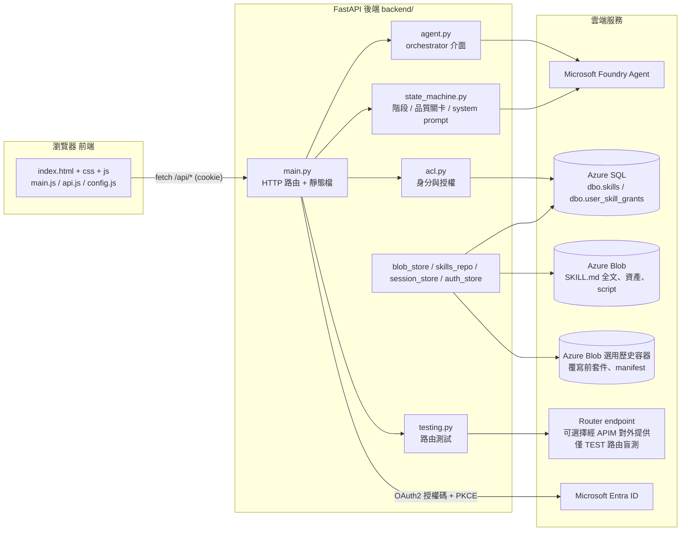
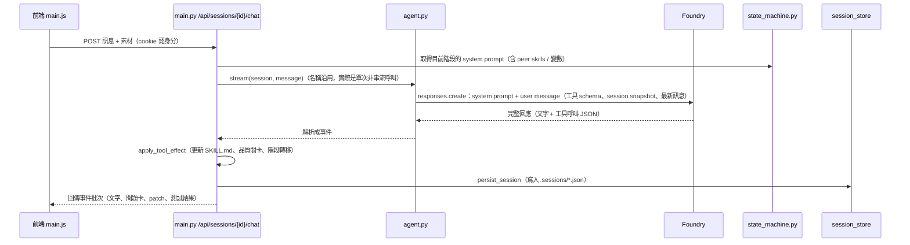
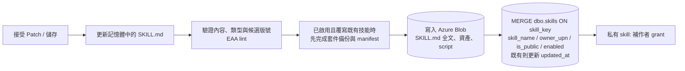

# 03 - 程式碼與系統架構

> 本文件給開發者：從大架構到單一檔案，快速了解前端、後端、資料庫、雲端如何串接，資料如何流動，以及**登入與 Token 的完整流程**。
> 專案在做什麼請見 [01-overview.md](01-overview.md)；啟動與設定請見 [02-setup.md](02-setup.md)；Agent 狀態機與工具請見 [04-agent-mechanism.md](04-agent-mechanism.md)。

---

## 1. 整體架構

單一 FastAPI 程序（`uvicorn`）同時提供前端靜態檔與 `/api/*`，對外串接 Foundry（AI）、Azure SQL、Azure Blob、Router endpoint 與 MCP 等服務。Router endpoint 可經 APIM 對外提供，也可直接使用任何實作相同 `/run` HTTP 契約的 runtime。

### 串接方式摘要

| 介面 | 協定 / 方式 | 說明 |
| --- | --- | --- |
| 前端 ↔ 後端 | `fetch` + 同源 cookie | 前端打 `/api/*`，帶 `credentials: include`；後端用 `sgv2_auth` cookie 認身分 |
| 後端 ↔ Foundry | Azure AI Projects SDK + Entra service principal | orchestrator 對話與研究 agent |
| 後端 ↔ Azure SQL | `mssql-python`（純 Python，AAD） | Skill metadata 與權限授權 |
| 後端 ↔ Azure Blob | `azure-storage-blob`（AAD，不支援連線字串） | `SKILL.md` 全文讀寫 |
| 後端 ↔ Router endpoint | `urllib`（HTTP） | 僅用於 TEST 路由測試；不限定 APIM，任何實作 `/run` 契約的 runtime 均可。body 頂層帶 `mode`，**一律 `route_only`**（scenario L3 改為對 L2 的回應做斷言，不發自己的請求），回應必須回顯同一個 `mode`；body 頂層另帶 `scenario`（scenario 測試送該 scenario 名稱以收斂 skill 池，capability 送空字串）；使用者委派 token **只放在 `Authorization: Bearer` header**，body 的 `credentials` 永遠是空物件（EAA 會把 credentials 變成 skill 的環境變數）；HTTP 401 中止整批回 502；**儲存後不再呼叫任何 sync 端點** |
| 後端 ↔ EAA MCP | JSON-RPC over HTTPS（app-only token） | 儲存前呼叫 `lint_skill_package`；`valid == false` 或 `status == "failed"` 擋下儲存，warnings 不擋，取不到判定則 fail-closed |
| 後端 ↔ Entra | OAuth2 授權碼 + PKCE（`urllib`） | 使用者登入與發 token |

### 雲端存取身分

| 服務 | 實際呼叫身分 | 選擇方式 |
| --- | --- | --- |
| **Microsoft Foundry Project** | `.env` 中 `AZURE_CLIENT_ID` 對應的 service principal | `DefaultAzureCredential()` 優先採用完整的 `AZURE_TENANT_ID` / `AZURE_CLIENT_ID` / `AZURE_CLIENT_SECRET`；需另授予 Foundry project 或 agent data-plane 權限 |
| **Azure SQL Database** | 與 Foundry 相同，即 `.env` 中 `AZURE_CLIENT_ID` 對應的 service principal | `ActiveDirectoryServicePrincipal`；沒有 Managed Identity 或 `az login` fallback |
| **Azure Blob Storage（skill）** | 本機為 `az login` 使用者；雲端未實測，見 [02-setup.md 附錄 A](02-setup.md#附錄-a改寫為雲端版本本-repo-未實測) | `DefaultAzureCredential(exclude_environment_credential=True)`：刻意排除 EnvironmentCredential，因此不使用上述 service principal |
| **Azure Blob Storage（session / auth，選用）** | 本機為 `az login` 使用者 | `ChainedTokenCredential(ManagedIdentityCredential(), AzureCliCredential())`；只在 `SGV2_SESSION_STORE` / `SGV2_AUTH_STORE=blob` 時使用，尚未實際測試（見 [02-setup.md 5.3](02-setup.md#53-多實例部署)） |
| **EAA MCP** | `MICROSOFT_*` App Registration 的 app-only token | client credentials 對自己換 `api://<app-id>/.default`；見 [2.4](#24-呼叫-eaa-mcp-的身分) |
| **Router runtime endpoint** | 網頁登入者的委派 token | 取自 `auth_store`，只放在 `Authorization: Bearer` header |

瀏覽器經 OAuth2 登入的使用者只負責網頁身分、Skill ACL 與 delegated/OBO token。這個使用者身分不會成為 Foundry、SQL 或 Blob 的連線身分。完整設定與角色需求見 [02-setup.md](02-setup.md#2-準備雲端資源)。

---

## 2. 資料流

### Scenario 編排負責者

`metadata.orchestration_owner` 只用於 scenario，接受 `host`／`eaa`；省略維持 Host。
[orchestration.py](../backend/orchestration.py) 提供共用 owner 契約，
[models.py](../backend/models.py) 保存 session 選擇，
[topology.py](../backend/topology.py) 以 T12 驗證欄位位置、舊流程欄位禁用、
EAA 非空正文與可執行的 children。Generator 仍只產出 scenario-orchestration／inline／script。

`POST /api/sessions/{id}/orchestration-owner` 只更新該使用者的 scenario session。
已有正文時須 `confirm_restart: true`，清除草稿、待接受工具／patch、失效測試及確認，
退回 PREPARE；舊正文暫存為唯讀重新生成來源，不在清稿時覆寫 Blob／SQL。
`owner_regeneration_pending` 防止遠端 hydration 補回舊稿，也阻擋測試舊遠端版本；
remote 綁定與版本 hash 保留。新正文通過共用存檔檢核後才完成切換。
一般編輯、patch 與 undo 不得繞過 owner selector 直接改編排負責者。

Host 路由測試仍檢查 parent 不出現在 capability 候選及 child 可達性。
EAA 的 route-only 只檢查 parent 已解析，L3 明確為未驗證，不推論 children 已執行。
真正套件仍送原 MCP lint 介面，不增加額外相容性探測呼叫。

### 2.1 一次對話回合的資料流

對話診斷以 JSON log 輸出到啟動 uvicorn 的終端，`SGV2_DEBUG_LOG=1` 啟用（預設開啟），不自動寫入檔案。每回合使用獨立的 `request_id`，跨執行緒傳到 Foundry 呼叫；`diagnostics_revision`、`process_id` 與 `source_file` 標示實際執行版本。`GET /api/inspect` 的 `diagnostics` 也回報版本、PID、後端來源與 SDK timeout／重試設定，可先確認正在跑的服務已載入 `foundry-phases-v2`。

| Log | 計時範圍 |
| --- | --- |
| `chat.phase.start/done/failed` | `phase` 區分 session 載入／保存、鄰居載入、取得下一個 Agent 事件、工具套用／保存與狀態快照 |
| `neighbor_full_md.sql.*` / `neighbor_full_md.blob.*` | 每個鄰居的 SQL 查詢與 Skill store 讀取，附 `skill_name`；store 可能命中快取 |
| `llm.prompt_build.*` / `llm.client_init.*` | prompt 組裝與 SDK／credential 初始化 |
| `llm.auth.*` | SDK 呼叫 token provider 的耗時，不記錄 token 內容；可能使用 credential 快取，不代表每次都向 Entra 發請求 |
| `llm.responses_create.*` / `llm.call.failed` | SDK 請求與失敗；請求時間包含驗證、網路及遠端處理，不能直接當成 Foundry trace 的 Agent 執行時間 |
| `llm.response.received` | `foundry_response_id` 與 SDK 提供的 `foundry_request_id`（若有），用於對照遠端回應 |
| `llm.client.config` | SDK timeout 為 120 秒，SDK 自動重試為 0 次；模型輸出 JSON 格式修復的單次重試是另一層機制 |

完成或失敗紀錄帶 `duration_ms`。卡住時依同一個 `request_id` 找最後一筆尚無 `.done`／`.failed` 的 `.start`；父子階段互相包含，不應將所有耗時相加。SDK timeout 是 HTTP I/O 等待設定，不是整個回合的硬性期限，初始化與驗證可能另花時間。前端 180 秒 timeout 不代表後端已取消，亦不能證明模型正在運算。Session 訊息時間差不是 Agent 執行時間。上述 chat 計時不涵蓋相依登入驗證、HTTP 回應編碼／傳輸及瀏覽器渲染。

### 2.2 儲存（接受 patch / 按下儲存）

接受 patch 後在記憶體更新 `SKILL.md`，並在綁定遠端 Skill 時嘗試**雙寫 Blob + SQL**。雙寫完成即生效，**沒有額外的 publish / sync 步驟**：runtime 每次請求都直接從 SQL + Blob 動態解析 skill（Mode B）。

實際寫入時機與流程：【建立 / 修改內容 -> 整理 skill data -> upsert 到 dbo.skills -> 若為既有 skill 修改，更新 updated_at -> 回傳最新資料給系統渲染】。

- **類型宣告**：每份產物都保存 `metadata.skill_type`：scenario 為 `scenario-orchestration`，且保留非空 `metadata.children`、不能有自己的 script；capability 有 script 時為 `script`，否則為 `inline`。內部仍分開使用 `SkillKind` 與 `skill_form`，不新增 SQL 欄位。T11 阻擋未知值、頂層宣告及類型與套件矛盾；不能只改宣告來轉換形式。未宣告類型的 capability 與相容別名 `code-generation` 可載入，儲存時才補齊正式值或正規化為 `inline`，不在讀取時改檔，也不覆寫明確矛盾的宣告。一般 session 與鄰近儲存都在版號計算與 EAA lint 前準備候選內容，成功後才回寫；既有額外 `scripts/` 檔案拒絕儲存而不自動刪除。分類不修改 ACL、`enabled`、`is_internal` 或後端候選過濾。
- **寫入時機**：REFINE 每個被接受的 patch、以及按下「儲存」都會雙寫 Blob + SQL（`save_skill_dual_write`）；DRAFT 被接受也雙寫。
- **patch 套用失敗**：V4A 解析、錨點缺失或不唯一等 `PatchError` 不修改草稿，也不新增 patch history；該次 `propose_patch` 從待確認工具清單移除，錯誤與 `call_id` 保存在 system message 的 `metadata.patch_error`。前端將卡片標為「Not applied」，停用 Accept／Reject 且不提供 Undo，仍可展開差異；接著請 Agent 提出修正版，由使用者另行確認。重新產生失敗也不會重新啟用原卡。載入 session 時只清理有相同 `call_id` 套用失敗紀錄的 patch 待辦，保留其他待辦；重新開啟對話會顯示未套用紀錄，而非可再次接受的失敗卡。
- **patch 套用與同步結果**：`tool-result` 可以接受 patch、保留本機內容，但同步仍被驗證或服務錯誤擋下。該次 tool message 的 `metadata.patch_sync` 帶入 `call_id` 與 `status: local | saved | failed`；失敗另帶 `detail`。前端只有 `saved` 才顯示「Saved to Blob + SQL」，`local`／`failed` 保留未同步狀態且不自動要求下一次測試；lint 失敗交回 Agent 修正，其他同步錯誤停止自動續跑。
- **內容版號**：Generator 的一般 session 與鄰近 skill 儲存，使用 `metadata.version` 的三段式 `MAJOR.MINOR.PATCH`。新 skill 宣告 `1.0.0`；首次儲存會將宣告的兩段式版號補成三段式。修改時以目的地已儲存的套件為基準，內容、script 或資產有變更就增加 PATCH，例如 `1.6` → `1.6.1`、`1.6.99` → `1.6.100`；不按修訂次數自動升 MAJOR／MINOR。作者明確提高 MAJOR／MINOR 時保留指定的新版號，Agent 不自行改版號。只改 PATCH 數字不算內容修訂，沒有內容變更的再次儲存不加號；還原內容後儲存則算新修訂，不倒退版號。未宣告版號的套件保持原樣；已有版號不能移除，也不接受非數字、前置零、預發行字尾或 YAML alias／anchor。候選新版號在 EAA lint 前準備，Blob／SQL 成功後才回寫 session；驗證失敗重試仍以同一已儲存版為基準。快照忠實保留覆寫前的原始 bytes，不修改其中版號；manifest 的 `from_version` 讀取快照舊內容的 `metadata.version`，`to_version` 讀取此次準備寫入的候選版號，例如 `"1.6"` → `"1.6.1"`，沒有版號或無法解析時為 `null`，不另行推算。這是嘗試儲存的版本變更，不保證後續正式寫入成功；沒有內容變更時兩個版號相同。manifest 的 UUID、來源 ETag 與檔案 SHA256 是另一組修訂識別，目錄日期則是 UTC 備份時間，不是內容最初修改時間。
- **寫入前的關卡**（依序，任一失敗就不寫）：既有 skill 的建立者權限（改名同時檢查來源，NEW 同名覆寫也適用）→ topology 驗證 → skill 資產檢查（見 [04-agent-mechanism.md 第 7.6 節](04-agent-mechanism.md#76-skill-資產assetsreferences)）→ `input_contract_errors`（含 EAA 會丟棄的 credentials 鍵名與平台 secret）→ 本專案 skill lint 的 error（script 型含 S 規則；有資產時含 F2/F3）→ script 型才有：重新查 ACA 的 EAA script 旗標，關閉就回 409 `script_flags_off`（見 [04-agent-mechanism.md](04-agent-mechanism.md#eaa-script-旗標)）→ EAA MCP `lint_skill_package`（見 [2.3](#23-eaa-skill-lint)）。
- **寫入順序**：完成關卡與候選版號驗證 → 選用的覆寫前備份 → `SKILL.md`（覆寫本 session 載入的 skill 時帶 `If-Match: remote_version_hash`，不符回 409 `version_conflict`）→ skill 資產（把 session 的完整集合寫到 `skills/<name>/assets/`、`references/`，並移除該資料夾內不在集合裡的檔案）→ script 型才有 `skills/<name>/scripts/<name>.py` → `upsert_skill`（bump `updated_at`）。四個名字一致：SQL `skill_name` = Blob 資料夾 = frontmatter `name` = script 檔名，都來自 `safe_skill_name(frontmatter name)`。script 由 server 端持有，`PUT /draft` 帶來的 script 會被忽略。
- **覆寫前備份（選用）**：設定 `AZURE_BLOB_HISTORY_CONTAINER` 後，共用 `save_skill()` 在任何正式檔案寫入前，先讀取目的地的舊套件，以來源檔案的 ETag 做條件式讀取，將原始 bytes 寫到獨立歷史容器。一般 session 與鄰近 skill 儲存都帶入已驗證登入者；首次建立與只能建立的改名目的地不備份。正式覆寫仍使用舊 `SKILL.md` 的 ETag 作條件，來源變更回 409；備份讀寫失敗回 503，不寫正式內容。未設定時維持一般儲存流程。
- **歷史格式與範圍**：路徑為 `<skill-name>/<UTC-timestamp>_<revision-id>/files/<relative-path>`，時間取自 manifest 的 `captured_at`，格式為 `YYYYMMDDTHHMMSSZ`，例如 `20261014T010954Z`；`revision-id` 是系統產生的完整 UUID，同一秒的多次備份仍各有獨立目錄。來源 store ID 與實際 Blob 路徑保存在 manifest，供追查來源；歷史容器可按環境分開設定。套件檔案全部完成、並再次檢查來源檔案清單與 ETag 後，最後寫同一版本目錄的 `manifest.json`。manifest 含 schema 版本、版本 ID、技能名稱、來源 store / Blob 路徑 / `SKILL.md` ETag、備份時間與觸發者、自然語言 `change_summary`，以及各檔案路徑、長度與 SHA256；不推定歷史作者。`change_summary` 描述此次嘗試儲存相對於快照舊套件的修改，不是快照內容摘要或儲存成功證明。Agent 在提案中以使用者語言說明實際變更，有對話依據時才融合修改原因，不附文字 diff。主 session 累積已接受而尚未儲存成功的說明，成功後清空；手動替換正文或 undo 清除可能失效的說明。鄰近 skill 沿選定版本到已儲存版本的來源鏈收集說明，切回其他分支時記錄版本切換。手動儲存 API 可帶 `change_summary`；沒有可信說明時留空，不額外呼叫模型推測。manifest 是稽核資料，不加入 skill 指令。只有 manifest 存在的版本才視為完整備份。備份完成不代表後續正式儲存成功；正式寫入衝突或 SQL 失敗時備份仍保留，備份中途失敗也可能留下沒有 manifest 的檔案。沒有自動清理、查詢或還原 API，改名不串接版本鏈；刪除或改名不移除歷史，管理面板刪除另要求最後版本快照，改名不額外建立快照。刪除快照標記 `operation: delete`、`change_summary: Before deletion`，不增加內容版號，`from_version` 與 `to_version` 均為被刪套件的版號。逐檔 ETag 檢查不是跨檔案交易，不能保證整包原子一致性或涵蓋 Gatekeeper 等外部寫入。
- **new vs modify**：new skill 首次儲存是 INSERT（同時寫 `created_by` / `created_at` / `updated_at`）；modify 既有 skill 是覆寫內容的 UPDATE。新建與改名目的地的 Blob 使用只能建立、不可覆寫的條件式寫入，名稱被其他寫入占用時回 409；只有 Blob、沒有 SQL metadata 的名稱也不能被認領。
- **upsert 行為**：`upsert_skill` 是 `MERGE dbo.skills`，比對鍵是 `skill_key`：不存在 -> INSERT `(skill_name, owner_upn, created_by, is_public, enabled, is_internal)`；已存在 -> UPDATE `is_public` / `enabled` / 指定的 `is_internal`，並**設 `updated_at = SYSUTCDATETIME()`**。`created_by` 只在 INSERT 填入，UPDATE 不修改，包括空白值；改名的新列沿用來源建立者。
- **絕不寫入計算欄位**：`skill_key` / `blob_path` / `blob_prefix` 都是 PERSISTED computed column，由 SQL 自行產生；應用程式若嘗試寫入會直接被 SQL Server 拒絕。
- **儲存不改可見性**：儲存是「內容」動作。`save_skill_dual_write` 一律**沿用** DB 現有的 `is_public`（新 skill 一律建為私有），因此接受 SKILL.md / 接受 patch / 接受改名都不會動到可見性。改可見性的**唯一寫入路徑**是 `PATCH /api/skills/{name}/visibility`。
- **授權**：私有 skill 儲存後會補一筆作者自己的 grant；`is_public = 1` 的 skill 不需要任何 grant。
- **updated_at 規則**：只要已存在 DB 的 skill 被再次修改並覆寫，`updated_at` 就更新為最新時間。
- **相鄰關係通知**：相鄰搜尋仍只使用作者可讀的候選清單與作者確認。確認路由 checkpoint 後，自己的鄰居沿用編輯／儲存流程；他人的鄰居只排入 session 待送關係，不產生對方的 description 或 patch。建立者空白時跳過並顯示原因。來源 Blob、SQL metadata 與授權儲存成功後才寫入 `dbo.skill_neighbor_notice`，以未結案的 `(skill_key, proposer_upn)` 去重並合併來源 key 清單；失敗保留待送狀態，來源保存成果不回滾，再次儲存可重試。
- **收件處理**：登入確認後，前端以 `GET /api/neighbor-notices/summary` 只查索引支援的 SQL 未結案數量，並與兩份 `/api/skills` 清單並行載入，不讀 Skill metadata 或 Blob；數量大於零時立即顯示右上角 badge 與固定待審閱提示列。使用者開啟通知後才呼叫 `GET /api/neighbor-notices` 載入完整 target／source frontmatter，提示列隱藏但 badge 保留到通知結案。通知清單只給收件人；卡片標示待審閱目標與通知提出者，來源 name／description 以可展開的相關 Skill 呈現。「略過並結案」直接結案。「開啟審閱」重新驗證目標精確 key 與建立者，載入目標最新套件及來源最新 name／description，建立 REFINE MODIFY（Quick Edit），session 保存成功就結案並記錄 session ID。第一輪 Agent 比較 description／When NOT to Use 的路由邊界，說明可能重疊或已清楚區分之處，需要調整才在 creator 確認方向後提出 patch；只有核心用途需變更且 creator 同意時才進 PREPARE。不預先替換 description，不授予來源使用權，也不提供來源正文、script 或資產；後續不儲存也不會重新開啟通知。建立 session 失敗保留未結案，重試沿用同一 session ID；重開已建立的 session 保留其當前階段，不重設為 REFINE。刪除、改名、停用或建立者異動不會 fallback 同名 Skill；來源不可用會明確標示。現有 MODIFY 只處理全域 Blob 路徑，私有 scope 目標保持未結案並回報不支援，不開啟同名全域 Skill。

#### 可見性（is_public）

可見性與內容分開處理，只由 `PATCH /api/skills/{name}/visibility` 寫入：

- **獨立管理入口**：生成卡片不提供 Public 選項，也不在接受 draft 後自動公開；新 Skill 預設不公開並補作者 grant。頁首「Manage Skills」不依賴 session 或 Modify 選單，儲存後的綁定狀態列也提供預選該 Skill 的入口。公開切換需確認，失敗時保留原設定。User／Group 選擇與授權操作始終顯示，不受 Public 勾選影響；公開不需要個別 grant，但仍可新增或撤銷，改回不公開時保留的 grants 決定使用權。
- **管理範圍**：`GET /api/permissions/skills` 只查 SQL metadata，列出 `created_by` 等於驗證登入者、且 `owner_upn IS NULL` 的全域 Skill，包含已停用項目，不依賴使用 grant 或 Blob 讀取。授權清單、新增、撤銷與可見性 API 均以 `assert_can_manage_permissions` 再檢查相同條件；公開或有使用 grant 不提供管理權，空白建立者與私人命名空間 Skill 拒絕管理。
- **SQL 授權對象**：`GET /api/permissions/principals` 供具有可管理 Skill 的登入者搜尋 `sys.database_principals` 中的 `E`／`X`，依名稱與類型篩選、最多 100 筆；Generator SP 需具備目標 principal 的 metadata 可見性。`E` 對應 User，選項提示其包含 SQL external users 與應用程式身分，不能視為完整人員名錄；`X` 對應 Group（Entra Security Group）。選取後 POST grant 帶 `principal_type`，後端重新查證 principal 存在與類型，再將個人 UPN 小寫化，群組則保留 SQL 原始名稱。群組名稱限 ASCII、最多 128 字元；不建 SQL user、不展開成員、不改 schema，也不呼叫 Graph。SQL 查詢失敗回 503，不放行未驗證對象；本機 store 沒有 Azure principal 名錄。
- **降回私有時補 grant**：改成 `is_public = 0` 會同時補一筆呼叫者的 grant，否則作者會失去自己 skill 的存取權。
- **internal children 跟隨 parent**：PATCH 會讀取 Blob 上該 skill 的 `children`，只對**同一建立者、全域且不在 host catalog 的 internal child** 套用同一個可見性（公開時一起公開、降回私有時一起降並補 grant）。已在 catalog 的 child 不由這支 parent 重新界定範圍；他人的或私人命名空間 child 不修改，列入 `failed_children`。單一 child 失敗不會中斷其他 child，結果會回在 `children` / `failed_children`，前端顯示未變更清單。個人／群組 grant 僅作用於選取的 Skill，不自動授權其 children。
- **群組使用與生效時間**：EAA 的互動讀路徑透過 OBO + SQL `v_my_skills`／RLS 判斷 Security Group 成員資格；群組須已依 EAA Case A2 建立 SQL principal 與 view 權限。Generator 仍以共用 SP 查個人 UPN grants，不因新增群組 grant 就取得登入者的群組使用視角。EAA 新增／撤銷 grant 與公開切換受其 RLS 清單快取 TTL 影響（預設 300 秒），不呼叫 `sync_skills`；Entra 成員變動另有傳播與 token／連線更新時間。

#### 管理刪除與依賴

- `GET /api/skills/{name}/dependencies` 沿用全域建立者管理檢查，直接掃描 live Blob 的全域與 private namespace，不用使用者清單或快取推定沒有引用。SQL 全部 `(skill_name, owner_upn)` 必須有對應內容，frontmatter 與 `metadata.children` 必須可解析，否則回 503、禁止刪除。回應列出本身的依賴與直接引用者的路徑；可修改的 scenario 提供開啟入口，無權查看的引用者只回數量、不回名稱。任何引用者都阻擋刪除，包括停用或 internal skill。
- `DELETE /api/skills/{name}` 要求 `confirm_name` 與名稱完全相同，UI 另有最後確認。先檢查依賴，再完成最後套件備份，備份後重新檢查建立者、依賴及來源版本，才刪 live Blob；檔案先於 HNS 目錄，目錄由深到淺，檔案 snapshot 一併刪除，只忽略真正的不存在。最後刪除 `dbo.skills`，grants 由 FK cascade 清除，不逐筆刪 grants，也不連帶刪其他 capability。
- Azure 刪除必須設定 `AZURE_BLOB_HISTORY_CONTAINER`。備份失敗不開始刪除；Blob 失敗保留 SQL 登錄並回報可能部分刪除，SQL 失敗則明確回報 live 已移除但登錄清理失敗，保留最後備份供管理員處理。兩種失敗都不假裝成功，沒有跨 Blob／SQL 交易或自動還原。
- 刪除不寫入、清空或備份 session。對話、素材、草稿與歷史維持原樣；`GET /api/sessions/{id}/binding` 只計算來源 SQL 是否還存在，前端重新開啟對話時顯示已刪除並停用 Save。既有 `save_skill_dual_write` 每次重新檢查來源建立者與 SQL 登錄，不允許舊對話將已刪來源重新建立。
- 成功刪除或可能部分刪除後清除本程序的 store index、ACL 與 `SkillsIndex`，前端刷新使用與 Modify 清單及管理選單。一般存檔、鄰近 skill 存檔與刪除共用程序內鎖，適用本機單程序操作；多 worker、多實例與 EAA 等外部寫入沒有共用鎖，不能保證並行修改時的完整依賴一致性。此情況應先由維運協調寫入時段；其他程序與 EAA 的快取依各自 TTL 生效，不宣稱立即同步。

### 2.3 EAA skill lint

儲存（`save_skill_dual_write()`）在寫入 Blob 前，先跑本專案的 skill lint，再透過 `MCP_ENDPOINT` 呼叫 EAA 的 MCP tool `lint_skill_package`，用 EAA 自己的規則檢核整個 skill package（實作：`backend/eaa_platform.py`、`backend/mcp_jsonrpc.py`）。本機不需要 EAA repo。

- Script 型 skill 在同一次呼叫一起送 `SKILL.md` 與 `scripts/<name>.py`，MI scope 等跨檔檢核才準。所有類型都要求 EAA 回報的 `ruleset_version >= 1.2`，確保已檢查類型宣告與套件一致性；低於門檻或版號無法辨識時回 **HTTP 503** 拒絕儲存。
- **fail-closed**：未設 `MCP_ENDPOINT`、token 取不到、連線失敗或回應解析不出判定，都回 **HTTP 503** 並擋下儲存。
- `status == "failed"`（request 或 package 不合法）回 **HTTP 400**，訊息列出 EAA 的 `error`。
- 本機 skill lint 或 EAA lint 有 ERROR 時回 **HTTP 400**，`detail` 為 `{kind: "skill_lint_failed" | "eaa_lint_failed", recoverable: true, message, issues}`。前端不顯示原始規則文字，而是告知使用者「未儲存、已請 Agent 修正」，並把 `issues` 送回 Agent：DRAFT 尚未儲存時重送完整 `propose_skill_draft`，之後則用 `propose_patch`。
- `warnings` 不擋儲存，儲存後寫成一則 system message 交給 Agent 轉述。其中 `metadata.mi_scopes: <資源> is not in MI_SCOPE_ALLOWLIST` 會改寫成部署說明（見 [04-agent-mechanism.md](04-agent-mechanism.md#eaa-平台規則d4d8a15)）。本機 lint 的 D7 INFO 只比對平台預設白名單；ACA 上的實際值由 EAA lint 在儲存時檢核。
- `ruleset_version` 記在 session 的 `eaa_ruleset_version` 與 `skill.save.done` / `mcp.lint.done` log。
- 本機 lint 的 **denylist 檢查刻意掃全文**，包含說明文字，因為 EAA 的模型也會照著說明文字做；這不是誤報，不要放寬。
- 本機 **N1 具名引用檢查**以完整已登錄 catalog 為字彙，包含未授權、內部與停用的 skill；名稱只留在伺服器，不回傳 catalog 或命中的名稱。`description` 與整份內文不得引用其他 skill 的名稱，自身名稱不受限。結構化依賴宣告及 scenario 已宣告依賴的實際 `fetch_skill(skill_name=...)` 參數保留；description、停止條件與一般依賴說明不享有例外。草稿提案與 SKILL.md patch 在修改內容、版號雜湊與 patch history 前先檢查，拒絕時不寫入；直接儲存也檢查，catalog 無法取得時回 HTTP 503 並停止。
- pytest 的 `backend_main` fixture 把 `lint_skill_package` 改成永遠通過；Playwright 設 `SGV2_E2E_FAKE_LINT=1`（需搭配 `SGV2_E2E_MODE`），不會呼叫真的 MCP。
- 鄰居 skill 編輯（`/neighbor-edits/{skill}/save`）在寫入前執行 N1 與原層級的分類驗證，以 Blob 保留的 script 準備候選宣告及版號，再呼叫相同的 EAA package lint；不走 `save_skill_dual_write()` 的完整本機 lint、資產或 ACA 旗標流程，不變更原有 script 與資產。

### 2.4 呼叫 EAA MCP 的身分

呼叫 `list_aca_environment_variables` 與 `lint_skill_package` 時帶的都是 **app-only token**，由 `MICROSOFT_CLIENT_ID` / `MICROSOFT_CLIENT_SECRET`（也就是負責網頁登入的那支 App Registration）以 **client credentials** 對**自己**換取，scope 為 `api://<app-id>/.default`。

- **為什麼不是使用者委派身分**：PREPARE 進入時的查詢跑在背景執行緒，只拿得到 session，沒有 HTTP request 也沒有使用者 token，等同無人值守。手動重新整理（`POST /api/sessions/{id}/aca-env`）雖然有登入者，仍刻意沿用同一個 app-only 身分，避免兩條路徑結果不一致。
- **audience 從哪來**：預設把 `MICROSOFT_OBO_SCOPE` 去掉 `/user_impersonation` 得到 `api://<app-id>`。MCP 伺服器驗證的正是這個值。若兩者不同支 app，才需要另外設 `MCP_OAUTH_AUDIENCE` 覆寫。
- **token 內容**：app 對自己做 client credentials，取得的 token **沒有 `scp` 也沒有 `roles`**。MCP 伺服器的 token 驗證不檢查這兩者，因此可以通過。
- **未設定時**：若 `MICROSOFT_OBO_SCOPE` 與 `MCP_OAUTH_AUDIENCE` 皆為空，就退回匿名呼叫（相容於不要求驗證的 MCP 部署）。這只在 MCP server 設 `MCP_AUTH_ENFORCE=off` 時可用；`challenge` / `validate` 下會收到 HTTP 401。
- **與路由測試無關**：TEST 階段呼叫 Router runtime endpoint 時送的是**使用者委派 token**，供 runtime 做 OBO 交換；app-only token 沒有使用者身分，不能用在那條路徑上。
- **平台 secret 不會交給 Agent**：ACA 查詢到的變數清單會先濾掉 `OBO_CLIENT_SECRET`、`TEAMS_NOTIFY_WEBHOOK_URL`、`LOGIC_APP_SKILL_REVIEW_URL` 再放進 prompt。它們存在於 ACA app 上，但 EAA 已從 skill 執行環境移除，列出來只會誘導 Agent 把它們當成可重用的 `aca_env`。`OBO_SCOPE_REGISTRY` 的值是公開的架構設定，其 key 同時用來判斷 caller 的 `credentials` 鍵名是否會被 EAA 丟棄（lint A15）；取不到時退回 `AZURE_SQL_ACCESS_TOKEN`、`GRAPH_ACCESS_TOKEN`。

---

## 3. 前端細節（frontend/）

純原生網頁，無建置框架；由後端 `main.py` 直接提供。

| 檔案 | 職責 |
| --- | --- |
| `frontend/index.html` | 單頁應用骨架：聊天區、工作流 stepper、素材 / 測試 / 檔案分頁、各種卡片與 modal |
| `frontend/css/style.css` | 全部樣式（卡片、表格、面板、disclosure 區塊等） |
| `frontend/js/config.js` | 設定 `window.SG_API_BASE = ""`（同源，`/api/*` 走相對路徑） |
| `frontend/js/api.js` | 所有後端 API 呼叫的封裝：`apiFetch`（帶 cookie）、建立 session、聊天、工具結果、測試、儲存、授權管理、`fetchSkillForm`（`GET /api/sessions/{id}/skill-form`）、`fetchMaterialViews`（`GET /api/sessions/{id}/material-views`）等 |
| `frontend/js/main.js` | 前端主控：渲染對話事件、問題卡、patch 預覽、測試結果、peer skills 面板；處理 tool 接受 / 還原、自動續轉（auto-continue）等 |

> 對話採「非串流」設計：後端把整回合事件收集成批次回傳，前端用同一套 `onEvent` 分派器重播。

建立或還原 session 時，前端分別顯示載入與讀取 ACA 環境設定的狀態；這段流程不呼叫對話模型。聊天請求送出後，立即顯示模型處理中與經過秒數，無須等待事件批次回傳。完成或失敗摘要保留在對話區，區分內容未變更、等待使用者確認與已更新；ACA 查詢失敗時則說明技能已載入但環境設定不可用。

Session 的 `ui_history` 保存依發生順序排列的畫面事件，`ui_history_cursor` 標記已處理的對話位置。一般文字參照 `conversation` 的索引；同一則助理訊息可用字元區段保留工具前後的顯示順序。工具事件只保存顯示所需的提案欄位、回答與結果，測試事件參照 `run_id`，不保存完整 `state_update` 或認證資料。`persist_session()` 在既有保存邊界同步這些事件；單純 Resume 不新增歷史。`_session_context()` 與前端的模型輸入預覽明確排除這兩個欄位，模型仍只取得最後 12 筆對話及目前狀態。

`renderLoadedSessionContent()` 依事件還原文字、唯讀歷史卡片、操作狀態與測試摘要，再以 `pending_tool_calls` 決定仍可操作的卡片，並依 `call_id` 去重。歷史呈現不綁定提交、Accept／Reject／Undo、儲存或測試操作。Patch 結果沿用 `patch_sync: local | saved | failed`，不以接受動作推定同步成功；後續儲存另記結果。缺少畫面事件時沿用可確認的對話文字與工具結果，不推測原問題、提案或時間順序。此紀錄屬於 session，不是 Blob 上 Skill 套件的版本備份。

MODIFY 選單使用 `GET /api/skills?purpose=modify`，只列出 `created_by` 等於登入者、已啟用且 Blob 內容存在的 skill，不以 grants 或公開狀態作為修改權。一般 `GET /api/skills` 保留可讀取清單，供 scenario 子 skill 選擇等用途；兩份清單分開保存。重新整理會重讀兩份清單，未通過建立者篩選的舊 session 目標不會被補回選單。

**Script 型 skill 在前端的呈現**（形式規則見 [04-agent-mechanism.md 第 7.5 節](04-agent-mechanism.md#75-code-素材與-script-形式)）：

- `GET /skill-form` 只在 capability session 有 `code` 素材或已鎖定為 script 時才呼叫，以 `session.updated_at` 快取；回應含 `form` / `locked` / `failures`（未滿足的條件）/ `replacement_problems`（新 code 素材為何沒取代已鎖定的 script）。
- Materials：code 素材列標出 `script` / `inline` / `not the script`，表格下列出未滿足條件或取代失敗的原因（旗標關閉時只列旗標）。被 Agent 改過（`origin=agent_patch`）的素材另標 `edited by agent · not run`，點標示開啟素材檢視視窗，可 Copy / Download（code 素材下載為 `.py`）；使用者自己再編輯，或確認 `script_covers_operations` 後消失。超出 prompt 預算的素材標 `agent sees N / M chars`（`GET /material-views`，同樣以 `session.updated_at` 快取）。
- 對話中的 `propose_material_patch` 以 `material-patch-card` 呈現 diff，接受 / 拒絕走同一個 `tool-result`。`stdout_fix=true` 的卡片顯示後端算出的 diff（寫在 `args.patch`），前端不分別處理。
- Checklist 的 `variables_ok`：「Output form」列顯示形式與是否鎖定，提供 inline / script 選擇（隨 Save variables 送出 `prefer_inline`）與「code 素材涵蓋所有操作」勾選框（送出 `script_covers_operations`）；兩者在 DRAFT 後停用。MODIFY session 另有「Convert form」列，按鈕呼叫 `POST /convert-form`；session 已有 patch 或請求執行中時停用。尚未有使用者訊息、且可轉換形式時，對話區上方另以單行呈現目前形式與轉換按鈕，說明放在資訊圖示的提示中；剩餘高度留給對話內容。
- Files：有 script 時出現 `SKILL.md | scripts/<name>.py` 切換，script 為唯讀。
- Draft 卡片註記會一併儲存 script；綁定狀態列與 modify 選單（`GET /api/skills` 的 `has_script`）標 `script` / `[script]`。
- Tests：每筆結果列出 `requested_scripts`（script 路徑、args、valid / invalid 與 problems）。
- 儲存收到 409 `script_flags_off` 時顯示後端訊息，不提供改成 inline 的選項。

**Skill 資產在前端的呈現**（規則見 [04-agent-mechanism.md 第 7.6 節](04-agent-mechanism.md#76-skill-資產assetsreferences)）：Materials 分頁下方的 Skill assets 區塊（`renderSkillAssets()`）。選目錄（`assets/` / `references/`）後按「Upload files…」逐檔上傳；每列顯示路徑、字元數、sha256 前 8 碼與 Replace / Delete。被拒收的檔案逐檔列出原因，可個別關閉，同批其他檔案照常上傳。scenario 或已鎖定為 script 的 session 停用此區塊並說明原因。Tests 分頁的每筆結果列出 runtime 回報的 Loaded resources 與 Failed resource reads，整批結果下方的 Resource reads 區塊列出 F4–F6。

---

## 4. 後端細節（backend/）

| 檔案 | 職責 |
| --- | --- |
| `main.py` | FastAPI 進入點：所有 `/api/*` 路由、靜態檔掛載、CORS、登入 / 回呼 / 登出、session CRUD、聊天、工具結果、儲存與雙寫、rename 流程 |
| `agent.py` | orchestrator 介面：工具 schema（`TOOL_SCHEMAS`）、從 `prompts/11_output_rules.md` 載入 AI 規則（`_load_output_rules`）、把 Foundry 的串流轉成事件 |
| `state_machine.py` | 五階段轉移表、品質關卡（quality gate）、組裝各階段 system prompt（含 peer skills、變數、研究結果） |
| `models.py` | Pydantic 資料模型：`Session`、`ChatMessage`、`SkillDraft`、`ResearchBrief`、`PatchRecord`、`TestResult` 等 |
| `acl.py` | 身分與授權：從請求取出 UPN（email）、`AclCache` 快取讀取授權、FastAPI 相依 `require_upn`；`assert_can_modify` 直接查 SQL 建立者，`assert_can_manage_permissions` 檢查建立者與全域 scope，兩者不使用 grant 快取 |
| `auth_store.py` | 登入狀態保存：`LocalAuthStore`（記憶體）與選用的 `AzureBlobAuthStore`（共用 / 多實例） |
| `session_store.py` | 撰寫 session 的 JSON 持久化（本機檔案，或 `SGV2_SESSION_STORE=blob` 改存 Blob）；以 `PERSIST_CONTEXT` 序列化，skill 資產全文只在這裡寫出 |
| `history.py` | Session 畫面歷史的欄位篩選、工具提案與結果記錄、對話參照及測試摘要同步；沿用 Session Store，不另建資料庫或儲存層 |
| `blob_store.py` | Azure Blob 版 Skill 儲存與 `SKILL.md` frontmatter 解析（含含冒號 description 的容錯）；script 型 skill 另存 `scripts/<name>.py`，列表以 `has_script` 標示，`SkillFiles.remove_script` 會刪除既有 script；skill 資產的寫入、清掃、讀取（`load_assets`），刪除 skill 時刪整個 prefix；選用的覆寫前完整套件備份與 manifest（獨立歷史容器，不隨 skill 刪除） |
| `form_conversion.py` | MODIFY session 的 inline ↔ script 機械轉換（`convert_session_form`）：搬移程式碼並同步 `metadata.skill_type`，不改寫正文 |
| `skill_assets.py` | Skill 資產的檢查（`check_asset`、`check_asset_set`、`assets_blocked_reason`）：只接受或拒收，不轉換 |
| `skills_repo.py` | Azure SQL 的 DAO：`dbo.skills` 與 `dbo.user_skill_grants` 的查詢 / upsert / 授權 / 可見性 / 刪除（一律以 `skill_key` 為鍵） |
| `neighbor_notice_repo.py` | 相鄰關係通知 DAO：未結案去重、來源 key 合併、SQL-only 未結案計數、收件隔離與立即結案；本機使用記憶體 store，Azure 使用 SQL 交易 |
| `skills_index.py` | 以 DB + Blob 組「既有 Skill 索引」，供 PREPARE 階段做重複偵測 |
| `testing.py` | 路由測試：把正負範例送到 Router endpoint，評估是否路由到本 Skill。端點可經 APIM 對外提供，也可直接連到相容 runtime；以 `mode=route_only` 送出（不執行腳本），驗證 runtime 的 `mode` 回顯（不符即中止整批），使用者 token 只送在 header、HTTP 401 中止整批（`RunAuthError`），並在持久化前遮蔽機密形狀；帶資產的 skill 另比對資源標示與 runtime 回報的讀取紀錄（`_check_resource_reads`） |
| `eaa_platform.py` | EAA runtime 對 skill 執行環境的規則：平台 secret denylist、caller `credentials` 保留鍵名、從 MCP 結果解析 `OBO_SCOPE_REGISTRY`；以及呼叫 EAA MCP `lint_skill_package` 並把結果對應成儲存判定的 fail-closed client |
| `patch.py` | 小型 V4A patch 解析與套用；`v4a_from_contents()` 從前後兩版產生供使用者審閱的 V4A diff |
| `material_patch.py` | `propose_material_patch` 的防線：以 AST 取出素材的外部呼叫（非 stdlib 或 I/O stdlib 的 import 起點 + 屬性鏈，不看變數名），patch 不得刪改任何一個，且邊界語句（import、只呼叫 print / json.dumps / argparse / exit 的語句、輸入綁定）以外的原始行改動（忽略縮排）不得超過 `MAX_CHANGED_RATIO`。patch 後仍有 script-form 問題的檢查在 `main._checked_material_patch()`；機械式 stdout 修正（`stdout_fix=true`）由 `skill_lint.stdout_to_stderr()` 計算、`main._checked_stdout_fix()` 把關 |
| `mcp_jsonrpc.py` | MCP JSON-RPC client（讀取 ACA 環境變數等）。以 `MICROSOFT_*` App Registration 對自己做 client credentials 取得 app-only token（audience 預設從 `MICROSOFT_OBO_SCOPE` 推導），並快取至過期前 60 秒；audience 推導不出來則退回匿名呼叫 |
| `db.py` | Azure SQL 連線輔助（`mssql-python`，AAD 驗證策略）；同一執行緒的巢狀查詢共用外層交易，避免通知處理中的建立者查詢提前 commit，暫時性失敗重試整筆交易 |
| `diagnostics.py` | 結構化記錄（`log_event` / `log_exception`）、追蹤上下文（`log_context`）與分段計時（`log_timing`），會遮罩疑似機密的值 |
| `e2e.py` | 本機 E2E 測試掛鉤（搭配 `SGV2_E2E_MODE`）：fake agent、fake 路由測試（script 型會附上 `requested_scripts`）、fake ACA 查詢（scenario `script_flags_on` 與 `material_patch` 才開啟 script 旗標；`material_patch` 在 PREPARE 對 code 素材提出固定的 `propose_material_patch`） |

---

## 5. 資料庫細節（Azure SQL）

| 資料表 / View | 欄位 | 用途 |
| --- | --- | --- |
| `dbo.skills` | `skill_name`, `owner_upn`(NULL=全域), `created_by`(`VARCHAR(256) NULL`), `is_public`, `is_internal`, `enabled`, `created_at`, `updated_at`；**計算欄位** `skill_key`(PK), `blob_path`, `blob_prefix` | Skill 的 metadata、建立者與可見性 |
| `dbo.user_skill_grants` | `user_upn`, `skill_key`(FK CASCADE), `granted_at`, `granted_by`, `expires_at`；PK = (user_upn, skill_key) | 授權主體可使用哪些 Skill；個人填小寫 UPN，Security Group 填 SQL principal 名稱 |
| `dbo.skill_neighbor_notice` | `id`, `skill_key`, `target_user`, `proposer_upn`, `source_skill_keys_json`, `status`, `created_at`, `updated_at`, `closed_at`, `modify_session_id` | 相鄰關係通知；`open` / `accepted` / `dismissed`，未結案的目標與提議者唯一，不存 description 或 patch，無刪除串連 FK |
| `dbo.v_my_skills` | 上述兩者的 join | 「目前登入者看得到的 skill」的官方語意定義 |

計算欄位公式（PERSISTED，**不可寫入**）：

| 欄位 | 全域 skill（`owner_upn IS NULL`） | 私有 skill |
| --- | --- | --- |
| `skill_key` | `skill_name` | `skill_name + '_' + owner_upn` |
| `blob_prefix` | `skills/<skill_name>/` | `skills/_private/<owner_upn>/<skill_name>/` |
| `blob_path` | `skills/<skill_name>/SKILL.md` | `skills/_private/<owner_upn>/<skill_name>/SKILL.md` |

約束：

- `CK_skill_name_format`：`skill_name` 只能是 `[a-z0-9-]`，不可用連字號開頭或結尾，長度 <= 64。
- `CK_skills_is_public_scope`：`is_public = 0 OR owner_upn IS NULL`——只有全域 skill 可以公開。

要點：

- `SKILL.md` **全文存在 Blob**，SQL 只存可查詢的 metadata 與權限。**schema v2 已移除 `description` 與 `version` 欄位**，description 的唯一真實來源是 Blob 上 `SKILL.md` 的 frontmatter。
- 可見性語意 = `enabled = 1 AND (有未過期的 grant OR is_public = 1)`。
- **內容修改語意** = `enabled = 1 AND created_by = 登入者的小寫 email`。建立者沒有使用 grant 仍能開啟 MODIFY 與儲存；非建立者即使有 grant 或 skill 為公開，也不能修改內容。空白建立者拒絕修改，不自動從 `owner_upn` 或 grants 推定。`owner_upn` 決定 scope 與計算欄位，不能替代建立者。
- **連線身分 ≠ 寫入的使用者**：`backend/db.py` 以 `AZURE_*` service principal（`ActiveDirectoryServicePrincipal`）連線，只決定能不能讀寫資料表。`dbo.skills.created_by` 由後端的 `require_upn` 取得已驗證登入者後填入，不能由前端指定，也不使用 SQL `CURRENT_USER` 或連線身分的預設值。grant 的 `granted_by` 同樣取驗證登入者；`user_upn` 則是選取的授權對象（個人 UPN 或 SQL 群組主體名稱，見上方可見性與 [6](#6-登入與-token-流程)）。
- **為什麼應用程式不直接查 `v_my_skills`**：本應用以**單一 service principal**（`ActiveDirectoryServicePrincipal`）連線 SQL，所有使用者共用同一個 DB 身分，因此 RLS 不會替我們做逐人過濾；而 `v_my_skills` 也沒有 `user_upn` 欄位可供外部帶入條件。`skills_repo` 在 base table 上顯式帶入 `g.user_upn = ?`，目前僅支援個人直接 grant 或公開設定，不解析登入者群組；EAA OBO 讀路徑的群組 grant 由 SQL RLS 判斷。Generator 的授權管理能力與使用清單的成員視角是兩條不同路徑。
- **`skills/` 這個前綴被寫死在計算欄位公式裡**。應用程式的 `blob_store.BLOB_ROOT` 必須與其一致，否則 SQL 的 `blob_path` 會指向應用程式從未寫入的位置，而且**不會有任何錯誤**。因此前綴不提供設定；`AZURE_BLOB_CONTAINER` 若以 `container/prefix` 形式帶入 `skills` 以外的前綴，服務會在啟動時直接拋錯。
- `is_internal` 是**可發現性**（是否投影給宿主的 `list_skills`），**不是權限**；權限一律看 grant 與 `is_public`。存 scenario skill 時，`save_skill_dual_write()` **只會**把 `PrepareBrief.delegation` 宣告的 child（真正被委派工作的能力層技能）以 `upsert_skill(child, is_internal=True)` 標為內部。`metadata.children` 本身是**依賴白名單**，還包含 `html-ppt` 這類通用技能；把它們標成內部會讓它們從**所有人**的 `list_skills` 消失，因此不在標記範圍內。移除 child 或刪除 scenario 時，共用的依賴掃描會讀取所有 scope 的 Blob frontmatter（包含登入者無權查看的項目），並核對 SQL 登錄是否都有內容；不完整時拒絕操作。孤兒提示只在「該 child 將失去這個 parent、目前 `is_internal = 1`，**且沒有其他 parent 的 `metadata.children` 引用它**」時觸發；共用 child 保留 internal。選 `make_capability` 會改回 `is_internal=False`，選 `keep_internal` 則保留 `1`；兩者都不變更 child 的 grants、公開或啟用設定。刪除前須先取得選擇，最終備份後再檢查引用；若新增需決定的孤兒，要求重新確認。`upsert_skill(is_internal=None)` 代表「不動既有值」，新列則取 schema 預設 `0`。
- 刪除 `dbo.skills` 的一列時，`user_skill_grants` 的相關授權因 FK CASCADE 一併清除。

---

## 6. 登入與 Token 流程

本系統採 **OAuth2 授權碼流程 + PKCE** 登入。本節只說明**流程**；App Registration 與環境變數的**設定**請見 [02-setup.md](02-setup.md#21-登入用-app-registration)。

### 流程概觀

`GET /api/auth/login` 產生 state + PKCE 後把使用者導去 Entra 登入 → 使用者授權後帶授權碼回 `GET /api/auth/callback` → 後端用授權碼（加 PKCE 與 client secret）跟 Entra 換到 `access_token` → 解析出使用者 email 當身分，並把 token 記錄留在後端、只發一個 cookie 給瀏覽器。

### 如何拿到 email

`/api/auth/callback` 用授權碼換到 `access_token` 後，後端 `decode_jwt_claims()` 解出 JWT claims，再用 `profile_from_claims()` 取 `email`（依序 `email` → `preferred_username` → `upn`，統一轉小寫）。這個 **email 就是使用者身分（UPN）**，對應讀取權限的 `dbo.user_skill_grants.user_upn` 與修改權限的 `dbo.skills.created_by`。之後每個請求由 `require_upn`（`acl.py`）讀 cookie → 取回 token 記錄 → 拿 `profile.email` 當 UPN。

### Token 存放在哪裡

- 換到的 `access_token`（連同 `expires_at` / `scope` / `profile`）存成一筆記錄，放在後端 **`auth_store`**，以一個隨機 `auth_id` 當 key（本機＝程序記憶體；可選 `SGV2_AUTH_STORE=blob` 改存 Azure Blob）。
- 瀏覽器只拿到一個 **httponly cookie `sgv2_auth=auth_id`**——**cookie 內只有不可猜的 `auth_id`，真正的 access token 不會外流到前端**。
- 後端要對下游系統做 OBO 委派呼叫時，用 `get_delegated_token()` 從這筆記錄取出 `access_token`。
- 登出 `POST /api/auth/logout` 會刪除該 token 記錄並清掉 cookie。

---

## 7. 重要慣例（給維護者）

- HTTP 請求一律用 `urllib`（`UrlRequest` / `urlopen` / `HTTPError`），不用 `requests`。
- 記錄用 `from .diagnostics import log_event, log_exception, now_ms, elapsed_ms`。
- 一般執行時 `main.py` 的 `.env` 會覆蓋既有環境變數；明確啟用 `SGV2_E2E_MODE` 或 `E2E_MODE` 的測試程序則保留程序的環境設定，尤其是獨立的 session 目錄。`LocalSessionStore(root=...)` 的明確路徑優先於環境變數；`/api/e2e/reset` 拒絕清除專案的正式 `.sessions`，且在拒絕時不變更 store 或記憶體 session。
- **`prompts/*.md` 是 AI 規則的唯一真實來源**，包含每回合注入的行為守則（`prompts/11_output_rules.md`）。`agent.py` 的 `FOUNDRY_OUTPUT_RULES` / `FOUNDRY_OUTPUT_SHAPE` 由 `_load_output_rules()` 於載入時解析該檔而來，**不再內嵌任何規則字串**。改規則請改 `.md`。
- 驗證語法：`uv run python -c "import ast; ast.parse(open('backend/<f>.py',encoding='utf-8').read())"`；匯入測試：`uv run python -c "import backend.main"`。