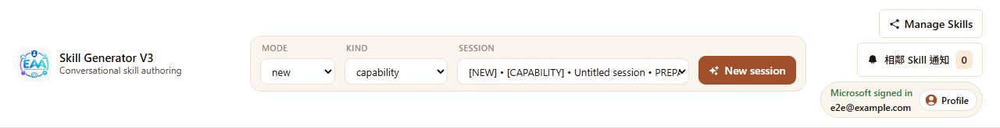
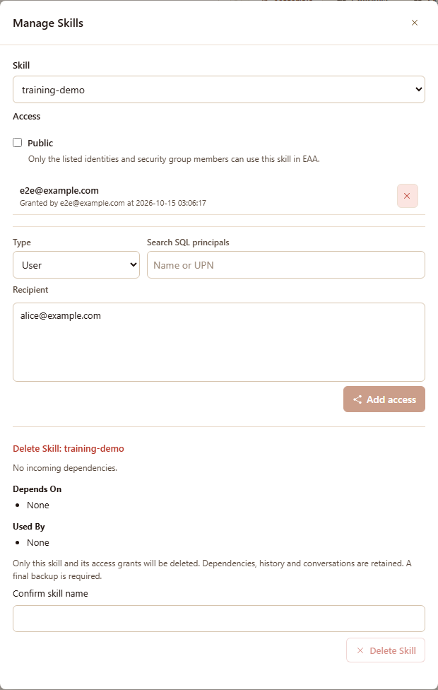
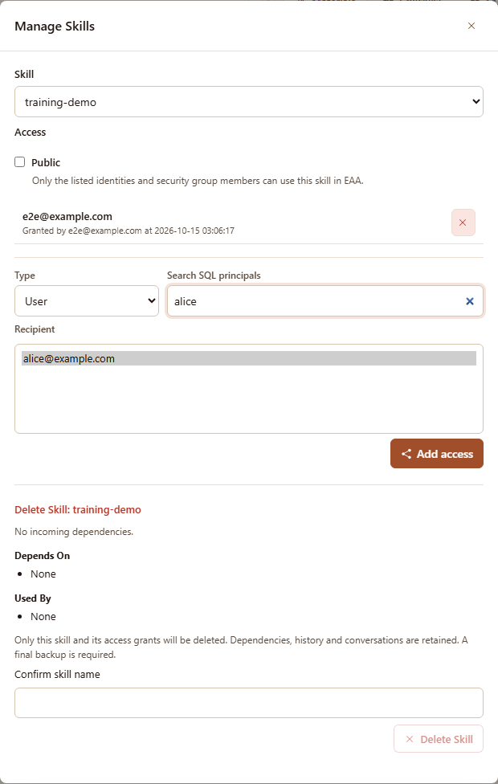
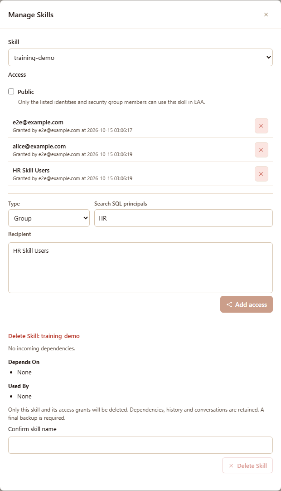
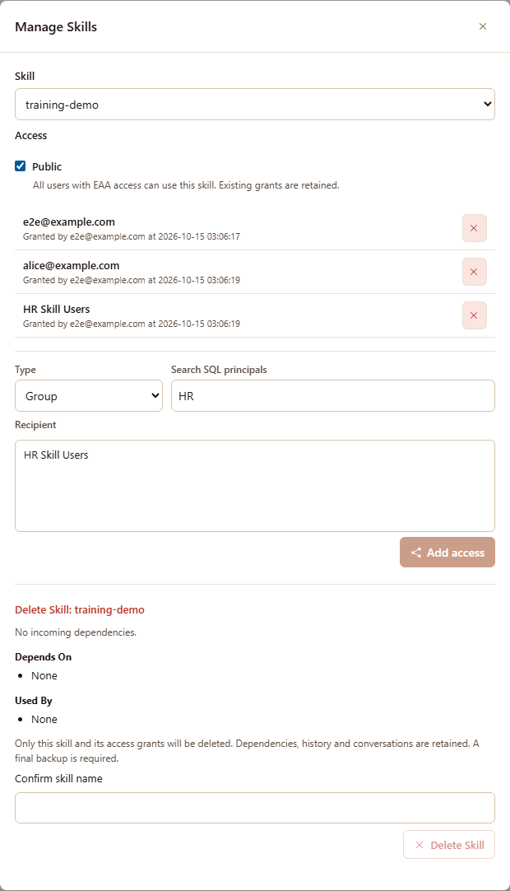
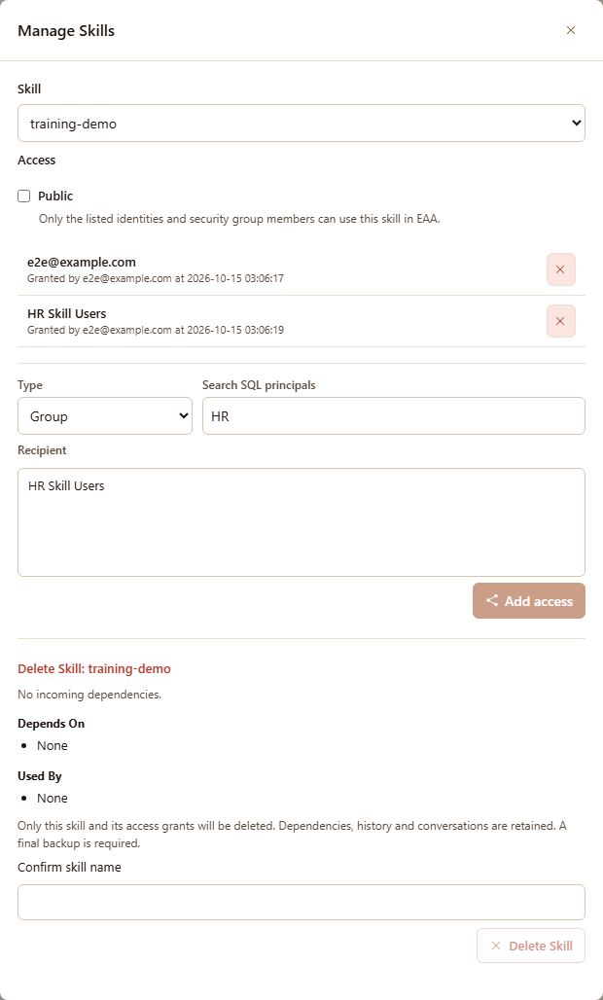
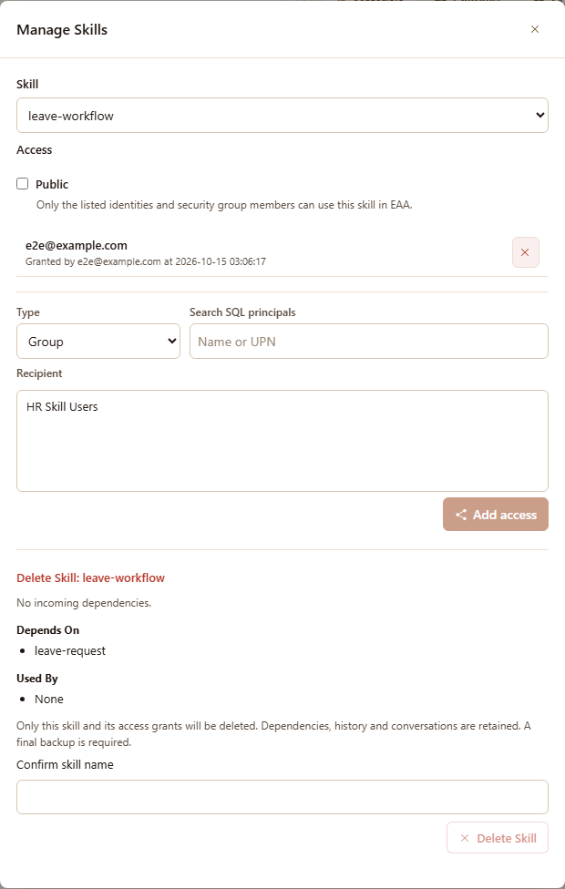
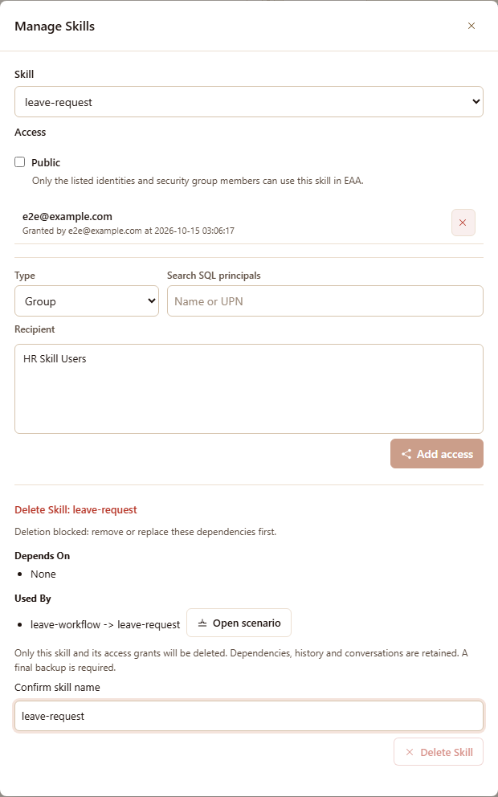
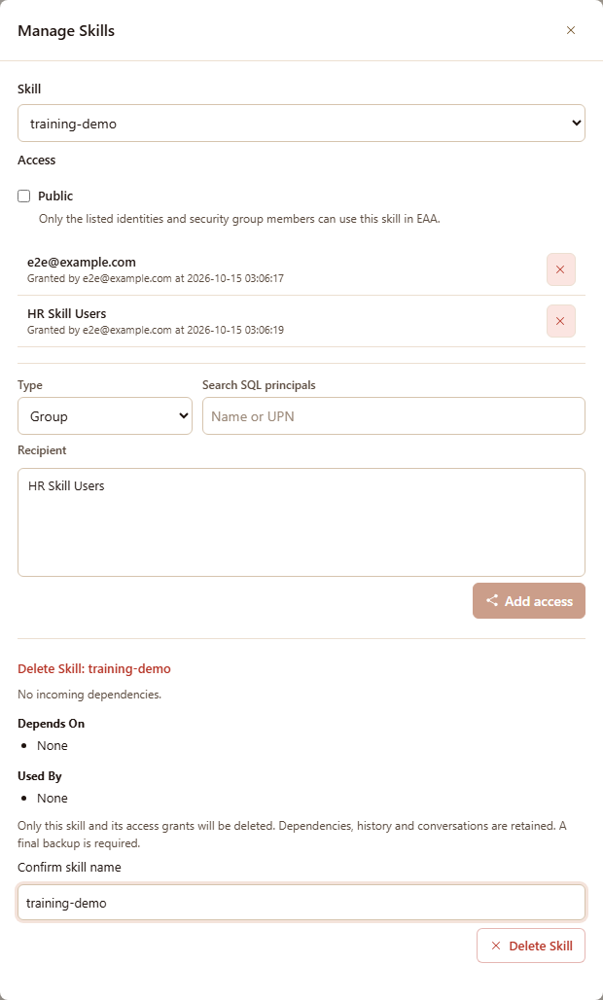
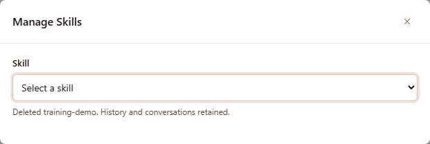

# 06 - Manage Skills 使用者指南

> 適用對象：已登入 Foundry Skill Generator、需要管理自己所建立 Skill 的作者。
> 本指南的截圖來自實際介面，使用本機示範資料；Skill、帳號與群組均為虛構，不代表已驗證正式環境的 Azure 授權或備份。

## 1. 開始之前

Manage Skills 用來設定 **誰能使用 Skill**、查看 **Skill 之間的相依關係**，以及刪除不需要的 Skill。修改 Skill 內容請使用 Generator 的 `modify` 流程，不是在此面板編輯。

- 先完成 Microsoft 登入，並確認 Skill 已儲存。啟動與登入步驟見 [啟動與設定指南](02-setup.md#4-啟動與登入)。
- 選單只列出**你建立的全域 Skill**，包含已停用項目；私人命名空間 Skill 不列入。
- 他人授權給你的 Skill、或他人公開的 Skill，不會因此變成你可管理的 Skill。**授權與公開設定不授予內容修改權。**
- 管理不需要先開啟對話，也不必等到 DONE 階段。

本指南使用三個範例：`training-demo` 示範授權與刪除；`leave-workflow` 引用 `leave-request`，示範相依關係。

## 2. 開啟管理面板

1. 在頁面右上方點選 **Manage Skills**。
2. 在面板的 **Skill** 選單選擇要管理的 Skill，例如 `training-demo`。
3. 等待授權清單與相依關係載入完成。

選擇 Skill 後，上半部 **Access** 顯示公開設定與授權清單，下半部 **Delete Skill** 顯示相依關係及刪除操作。

**另一個入口：**儲存 Skill 後，可直接點選對話中 Skill 綁定狀態列的 **Manage Skills**，面板會自動選取該 Skill。

關閉面板可點選右上角的叉號，或按 `Esc`。授權與公開設定在各次操作成功時即生效，**不需要另外按儲存**；關閉面板不會撤銷已完成的操作。

## 3. 授權給個別使用者

1. 確認 **Skill** 是你要分享的項目。
2. 將 **Type** 設為 **User**。
3. 在 **Search SQL principals** 輸入名稱或 UPN，例如 `alice`。
4. 在 **Recipient** 清單點選正確的身分，例如 `alice@example.com`。
5. 點選 **Add access**。
6. 確認該身分出現在上方授權清單，並檢查授權者與時間。

**預期結果：**不需將 Skill 設為 Public，也能讓指定身分在 EAA 使用此 Skill。

> 收件人來源是 Azure SQL 已登錄的 external principals，不是任意輸入 email 就能授權，也不是直接搜尋整個 Entra 目錄。**User** 類型亦可能包含應用程式身分，請核對名稱後再加入。找不到對象時，請管理員確認 SQL 身分設定。

## 4. 授權給群組

1. 將 **Type** 改為 **Group**。
2. 在 **Search SQL principals** 輸入 Security Group 名稱的關鍵字，例如 `HR`。
3. 在 **Recipient** 選擇正確群組，例如 `HR Skill Users`。
4. 點選 **Add access**。
5. 確認群組出現在授權清單。

**預期結果：**符合該安全群組成員資格的使用者可在 EAA 使用此 Skill。群組授權不會把群組成員變成 Skill 作者，也不授予管理或修改權。

## 5. 設為公開或改回私人

| Public 設定 | 誰能在 EAA 使用 | 授權清單 |
| --- | --- | --- |
| 未勾選（私人） | 清單中的身分與安全群組成員 | 依清單授權 |
| 勾選（公開） | 所有具備 EAA 存取資格的使用者 | 原有授權保留，可繼續管理 |

### 設為公開

1. 勾選 **Public**。
2. 閱讀瀏覽器確認視窗；確認要開放給所有具備 EAA 存取資格的使用者後，再接受。
3. 確認提示變為 **All users with EAA access can use this skill. Existing grants are retained.**

**公開不是匿名網際網路存取**，也不代表所有人都能編輯 Skill。公開時，符合條件的內部子 Skill 可能一併調整；若面板列出未變更的子 Skill，請確認提示並處理，不要假設整個流程已全部開放。

### 改回私人

1. 取消勾選 **Public**。
2. 確認提示變為 **Only the listed identities and security group members can use this skill in EAA.**
3. 檢查保留的授權清單，確認仍符合預期。

**預期結果：**Skill 改依授權清單提供使用權，不會清空既有授權。不要據此假設其他相關 Skill 的公開設定也已同步關閉。

## 6. 移除使用權

1. 在授權清單找到要移除的使用者或群組。
2. 點選該列右側的叉號按鈕（**Remove access**）。
3. 在瀏覽器確認視窗確認移除。
4. 確認該列已從清單消失。

下圖中，`alice@example.com` 的個別授權已移除，作者與 `HR Skill Users` 群組授權仍保留。

> **移除一筆授權不一定會讓對方失去使用權。** 若 Skill 仍為 Public，對方仍可能使用；若對方屬於另一個已授權群組，也仍可能透過群組取得權限。請同時檢查公開設定與群組授權。

## 7. 看懂相依關係

在 **Delete Skill** 區查看兩個欄位：

| 欄位 | 意義 | 範例 |
| --- | --- | --- |
| **Depends On** | 目前 Skill 依賴哪些 Skill | `leave-workflow` 依賴 `leave-request` |
| **Used By** | 哪些 Skill 引用目前 Skill，並顯示引用路徑 | `leave-workflow -> leave-request` |

選擇 `leave-workflow` 時，**Depends On** 顯示 `leave-request`。**No incoming dependencies.** 只表示沒有其他 Skill 引用目前 Skill，並不表示它沒有依賴別人。

### 被引用而無法刪除

選擇 `leave-request` 時，**Used By** 顯示 `leave-workflow -> leave-request`，並出現 **Deletion blocked: remove or replace these dependencies first.**。即使輸入正確名稱，**Delete Skill** 仍不可按。

1. 檢查 **Used By** 的引用路徑。
2. 若有 **Open scenario** 按鈕，可開啟該 scenario 的修改流程，先移除或替換對目前 Skill 的依賴，並儲存變更。
3. 若顯示 **contact the creator**，請聯絡引用者的建立者處理。
4. 若出現 **restricted reference(s)**，表示有你無權查看的引用者；名稱不會公開，請聯絡管理員。
5. 處理後重新開啟管理面板並選擇目標 Skill，確認相依檢查已不再阻擋刪除。

## 8. 刪除 Skill

> **刪除前必讀：**系統必須先完成最後版本備份；管理員需先設定獨立的歷史容器，見 [Azure Blob 設定](02-setup.md#25-azure-blob)。本介面沒有復原按鈕，請勿把「保留備份」視為可自行還原。

1. 在 **Skill** 選單選擇要刪除的項目，例如 `training-demo`。
2. 確認 **Used By** 沒有阻擋刪除的引用，並已完成相依檢查。
3. 在 **Confirm skill name** 輸入完整名稱 `training-demo`，必須完全相符。
4. 確認 **Delete Skill** 按鈕可用，再點選它。

5. 瀏覽器會詢問是否刪除該 Skill 與其存取授權，並提醒無法在此還原。不確定時請取消；確定後才接受。
6. 若刪除 scenario 會讓內部子 Skill 失去最後一個引用，瀏覽器會列出這些子 Skill，詢問是否將它們顯示為獨立 capability（`is_internal = 0`）。拒絕後可再選擇保留 internal（`is_internal = 1`）；兩次都取消則不執行刪除。這個選擇不會改變子 Skill 的公開設定、啟用狀態或存取授權。
7. 等待操作完成。成功時面板顯示 **Deleted training-demo. History and conversations retained.**，該 Skill 也會從選單移除。

| 刪除的內容 | 保留的內容 |
| --- | --- |
| 目前 Skill 的正式套件與登錄，以及它的存取授權 | 依賴的其他 Skill、歷史備份與對話紀錄 |

同一個 capability 可被多個 scenario 引用；仍有其他引用的子 Skill 會保留 internal，不列入上述選擇。系統會檢查所有 Skill，而非只檢查你看得到的項目；掃描不完整時不允許刪除，引用者的受限名稱也不會公開。最終備份後會重新檢查，若多出需決定的子 Skill，請重新確認後再刪除。

若某段對話綁定的 Skill 已刪除，對話仍保留，但狀態會顯示 **Skill deleted**，不能再直接儲存至該 Skill。

## 9. 常見問題

| 畫面或情況 | 建議處理 |
| --- | --- |
| **No skills available for management.** | 確認登入帳號正確，且已儲存自己建立的全域 Skill。被授權、公開可用或私人命名空間的 Skill 不會因此列入。 |
| **No matching SQL principals.** | 確認 Type 與關鍵字；請管理員確認該身分或 Security Group 已登錄於 SQL。 |
| **Add access** 無法按 | 在 Recipient 清單明確點選一個結果；只輸入搜尋文字還不算選取。 |
| 公開後顯示部分子 Skill 未變更 | 依提示檢查相關子 Skill 的設定與權限；不要假設所有依賴均已開放。 |
| 移除授權後對方仍可使用 | 檢查 Public 是否仍勾選，以及對方是否屬於其他已授權群組。 |
| **Delete Skill** 無法按 | 檢查名稱是否完全相符、是否仍被引用，以及相依檢查是否完成。 |
| **Deletion unavailable** | 相依檢查未能完成，暫時不能刪除；重新選取 Skill 再試，持續失敗請聯絡管理員。 |
| 備份未設定或 **Final backup failed** | 尚未開始刪除；請管理員檢查歷史容器與讀寫權限，修復後再試。 |
| 其他刪除錯誤 | 不要視為成功；保留錯誤訊息並請管理員核對目前套件與登錄狀態。 |
| **Permission denied** 或 403 | 確認登入者是 Skill 建立者；讀取／使用授權不提供管理權。 |

---

**維護註記（非使用步驟）：**截圖由 `tests/e2e/manage-skills-guide.spec.ts` 產生，預設略過。更新時先確認測試資料隔離並備份實際對話目錄，再使用本機 session/auth store，設定 `SGV2_GUIDE_SCREENSHOTS=1`，執行 `npx playwright test tests/e2e/manage-skills-guide.spec.ts --project=chromium`。Playwright 自行啟動測試伺服器；不要對正式服務呼叫 E2E reset。截圖中的主體搜尋與授權使用示範 fixture，不作為真實 SQL 身分驗證或 Azure 備份的證據。