# 07 - Generator 完整使用者指南

> 適用對象：要透過對話建立、修改與驗證 Skill 的作者。安裝、雲端資源及登入設定請見 [啟動與設定指南](02-setup.md)；授權、公開及刪除請見 [Manage Skills 使用者指南](06-manage-skills-guide.md)。
>
> 圖片由實際介面搭配本機示範資料產生。`e2e-calendar-skill`、測試帳號與固定 Agent 回覆只用來示範操作，不是可直接部署的日曆實作；畫面中的 100% 為模擬路由測試結果，不代表真實 Azure、Microsoft Graph 或業務流程已通過驗證。

## 操作路線

第一次使用，依序閱讀第 1–10 節；修改已儲存的 Skill 看第 11 節；需要 scenario、script 或附帶檔案時，再看第 12–14 節。

| 你的目的 | 前往 |
| --- | --- |
| 登入、認識畫面、建立第一個 Skill | [1. 登入與準備](#1-登入與準備)、[2. 認識工作區](#2-認識工作區)、[3. 建立新對話](#3-建立新對話) |
| 整理素材、回答 Agent、確認範圍 | [4. 附加素材](#4-附加素材)、[5. 完成準備與確認](#5-完成準備與確認) |
| 審閱與儲存初稿 | [6. 審閱初稿並首次儲存](#6-審閱初稿並首次儲存) |
| 微調內容與審閱 Patch | [7. 精修與-patch-審閱](#7-精修與-patch-審閱) |
| 驗證路由、完成驗收、接續對話 | [8. 設定與執行路由測試](#8-設定與執行路由測試)、[9. 完成驗收](#9-完成驗收)、[10. 恢復對話](#10-恢復對話) |
| 修改、編排、script 與資產 | [11. 修改既有-skill](#11-修改既有-skill)、[12. 建立-scenario-型-skill](#12-建立-scenario-型-skill)、[13. 使用-script-形式與轉換](#13-使用-script-形式與轉換)、[14. 附帶-skill-資產](#14-附帶-skill-資產) |
| 看懂輔助視圖、通知、錯誤 | [15. 輔助視圖](#15-輔助視圖)、[16. 分享與相鄰-skill-通知](#16-分享與相鄰-skill-通知)、[17. 常見問題](#17-常見問題) |

## 1. 登入與準備

1. 確認管理員已完成 [啟動與設定](02-setup.md#4-啟動與登入)，並啟動 Generator。
2. 開啟 <http://localhost:6274/>；點選 **Sign in**，完成 Microsoft 登入與授權。
3. 回到 Generator 後，確認右上角顯示 **Microsoft signed in**，並核對帳號。可從 **Profile** 查看登入資訊。
4. 準備需求說明、資料來源、API 文件或已驗證的程式碼，以及「應該使用／不應使用」這個 Skill 的查詢範例。

**不要把 client secret、token、密碼或真實個資貼進對話、素材或資產。** 認證需要哪些權限可以描述，但不要提供憑證值。

Generator 的對話進度與已發佈 Skill 是不同資料：**對話可恢復，不表示目前草稿已儲存到共用知識庫。**

## 2. 認識工作區

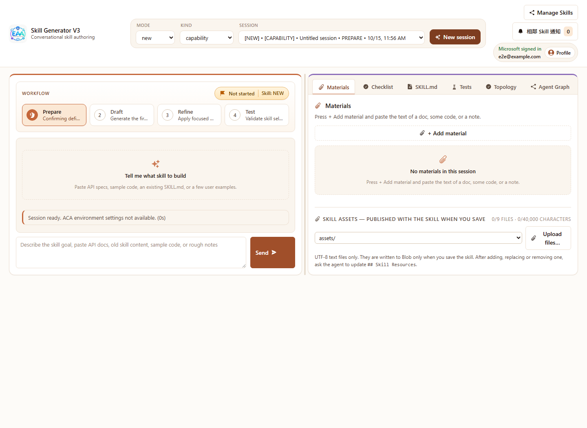

| 區域 | 用途 |
| --- | --- |
| **Mode / Kind / Skill / Edit** | 決定建立或修改、Skill 類型，以及修改時從哪個階段開始。部分欄位只在 modify 顯示。 |
| **Session / New session** | 恢復既有對話，或建立新的工作對話。 |
| 左側 **Workflow** | 顯示目前階段與 Skill 儲存狀態；下方是對話、問題卡、初稿卡與 Patch 卡。 |
| 左下輸入框與 **Send** | 描述目標、補充資料、回答問題或要求下一步。 |
| **Materials** | 提供 Agent 參考的素材，以及要隨 Skill 發佈的資產。 |
| **Checklist** | 查看定義、路由邊界、變數或委派關係是否已確認。 |
| **SKILL.md** | 左邊 Source、右邊 Preview；script 形式會再提供 script 檔案切換。 |
| **Tests** | 維護正負面查詢、跑路由測試與查看結果。 |
| **Topology / Agent Graph** | 查看結構檢查與 Agent 工作流程說明。 |
| **Manage Skills / 相鄰 Skill 通知** | 管理已儲存 Skill 的使用權，或審閱其他作者送來的關係通知。 |

左右面板與 Source／Preview 之間的分隔線可拖曳調整。較長內容要在對話區或右側工作區內捲動；下方的操作不一定都在第一屏。

### 五個階段代表什麼

| 階段 | 你要做的事 | 完成的判斷 |
| --- | --- | --- |
| **PREPARE** | 說清楚需求、來源、邊界、輸入與認證；回答確認問題。 | Checklist 有足夠內容且已確認，Agent 可產生初稿。 |
| **DRAFT** | 檢查第一版內容與名稱，接受並首次儲存。 | 儲存成功，進入 REFINE。 |
| **REFINE** | 指出具體差異，審閱需要的修改。 | 沒有待處理修改或錯誤，可測試或驗收。 |
| **TEST** | 驗證正確路由、排除誤選，依結果決定是否修正。 | 結果符合預期，或清楚記錄尚未驗證項目。 |
| **DONE** | 確認工作已完成。 | 最新版本已儲存，驗收範圍與限制已確認。 |

階段由 Agent 與品質關卡推進，**不是點選階段名稱就能跳過檢查**。REFINE 不要求一定修改一次；不需路由測試時也可驗收，但不能把未測試說成已通過。

## 3. 建立新對話

1. 將 **Mode** 設為 **new**。
2. 選擇 **Kind**：一般獨立能力選 **capability**；要編排其他 Skill 的流程選 **scenario**。
3. 點選 **New session**，等待 **Session ready** 或環境查詢完成訊息。
4. 確認畫面停在 PREPARE，再輸入需求並按 **Send**。

可參考這種需求寫法：

```text
建立一個查詢團隊可用會議時段的 Skill。
使用者提供日期範圍、時區與參與者，結果要列出候選時段。
只讀取行事曆，不建立、不修改，也不刪除會議。
請先確認資料來源、必要權限與缺少輸入時的行為，再產生草稿。
```

**預期結果：**Agent 開始確認定義與邊界，而不是要求你自行撰寫整份 Markdown。正式環境可能需要多輪追問，不會像固定示範回覆一樣一次完成所有關卡。

**New session 是新的對話，不是「儲存」按鈕。** 接續原本工作請使用 Session 選單，避免不必要地建立另一個平行對話。

## 4. 附加素材

1. 開啟 **Materials**，點選 **+ Add material**。
2. 選擇適合的素材種類，貼入完整文字。
3. 點選素材列的附加按鈕，確認素材已出現在清單；如畫面自動切到 Checklist，可再切回 Materials 檢查。
4. 在對話中說明這份素材的用途、哪些地方已驗證，以及哪些內容不應被改寫。

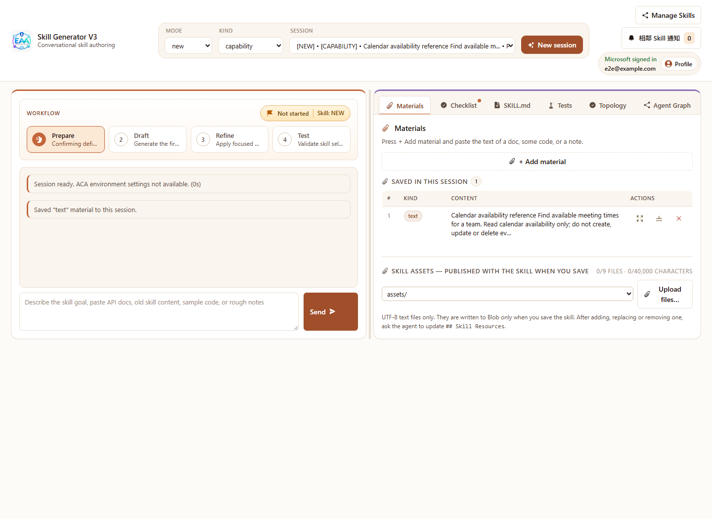

| 素材種類 | 適合提供 | 作者應注意 |
| --- | --- | --- |
| **text** | 需求、流程、限制與背景說明 | 背景不等於已驗證的 API 契約；請補上實際文件。 |
| **api_spec** | API 規格、欄位名稱、端點與回應格式 | 名稱與型別需準確，不要只貼一段模糊摘要。 |
| **code** | 已驗證的程式碼 | 說明驗證範圍；要成為 script 時另有完整性與平台條件。 |

**素材與資產不同：**素材供 Agent 理解與生成內容；資產是原封不動隨套件發佈的檔案，操作見 [第 14 節](#14-附帶-skill-資產)。

## 5. 完成準備與確認

### 回答確認卡

1. 閱讀左側 **Decision needed** 卡片。
2. 選擇符合需求的選項；必要時在 **Custom answer** 補上限制。
3. 點選 **Submit answers**，等待提交結果。
4. 若改用對話輸入框回答，請清楚指出回答哪個問題；留意卡片是否已更新為已回答。

同一組決策會集中確認：例如同一子技能要納入哪些操作，Agent 會列出整組建議供接受或
調整，而不是每個操作各等一輪。需要分別選擇時，同一張卡可包含多題；完成各題後只需按
一次 **Submit answers**。已明確回答的內容不必重答，空白或不明確的部分才會再追問。
有先後依賴的問題（例如編排負責者、正面樣本與後續負面樣本）仍會分開處理。

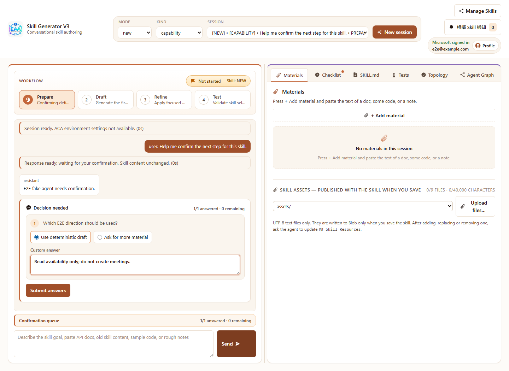

**預期結果：**卡片顯示已提交的答案，Agent 取得這次決定後繼續。選了選項但沒有提交，不應視為已完成確認。

### 檢查 Checklist

1. 開啟 **Checklist**，展開目前要處理的關卡。
2. 確認 **Skill definition** 中的目標、資料來源與核心能力符合需求。
3. 在 **Routing & uniqueness** 核對相鄰 Skill、區分點、不處理的情境與正負面查詢。
4. capability 另確認 **Variables verified**；scenario 另確認依賴與委派，見 [第 12 節](#12-建立-scenario-型-skill)。
5. 若已確認的內容有誤，可用 **Revise this checkpoint** 重新檢視，並在對話中說明要改什麼。

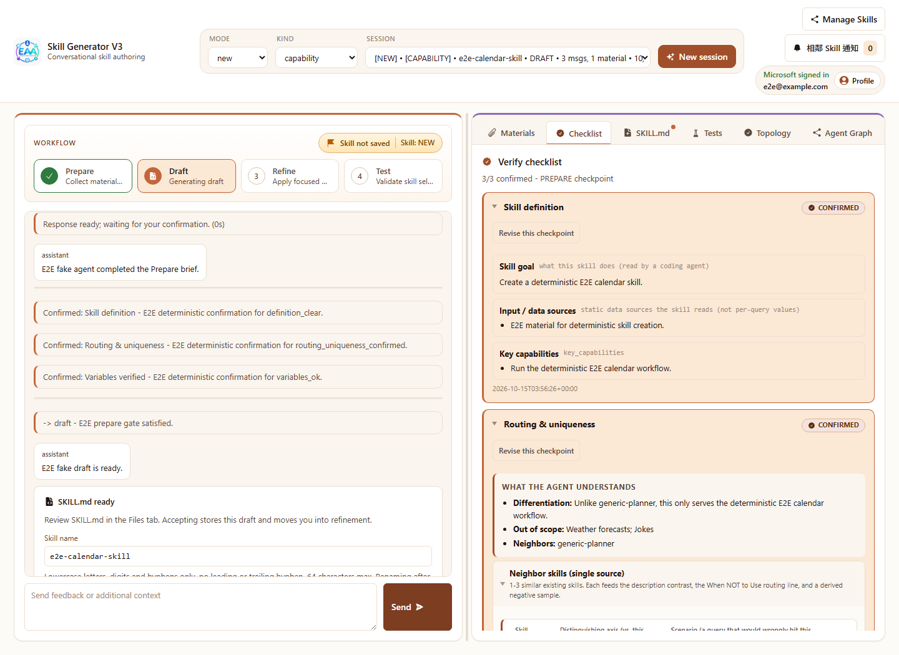

> 不要只追求顯示 3/3。若目標、相鄰 Skill 或輸入定義錯誤，即使已確認，也應先修正內容；變更前面的決定可能讓後續關卡需要再次確認。

### 輸入與認證怎麼確認

| 項目 | 你要確認的內容 |
| --- | --- |
| 部署環境變數 | 哪些 ACA 設定可重用、哪些需新增；不要把實際機密值貼進對話。 |
| OBO 權限 | 用哪個已註冊的委派 scope，是否符合實際 API 最小權限。 |
| 業務輸入 | 欄位名稱、必填與否、缺值行為，以及由哪個管道傳入。 |

業務輸入選 **Credentials (key/value)** 時，值由具名欄位傳入，適合 ID、日期、金額與選項代碼；選 **Request** 時，值由 Agent 從任務文字取出，適合摘要或事由等自由文字。這裡的 credentials 是傳值管道，**不代表應該把密碼當成業務輸入**。每個欄位只指定一個來源，缺值時不應期待另一個來源自動補上。

環境查詢未啟用或失敗時，不要把結果當成「已確認部署設定」。先釐清缺少哪些資訊；script 形式尤其依賴這個查詢。

## 6. 審閱初稿並首次儲存

1. Agent 產生 **SKILL.md ready** 卡片後，開啟右側 **SKILL.md**。
2. 對照 Source 與 Preview，檢查名稱、description、適用／不適用範圍、必要輸入、認證、程式碼與失敗行為。
3. 在初稿卡的 **Skill name** 確認名稱。只能用小寫英文字母、數字與連字號，不可用連字號開頭或結尾，最長 64 字元。
4. 確認內容後，點選卡片的 **Accept SKILL.md**，或右側 **Save skill**。
5. 等待儲存完成，確認狀態變為 **Skill saved (latest)**，且綁定的是正確 Skill。

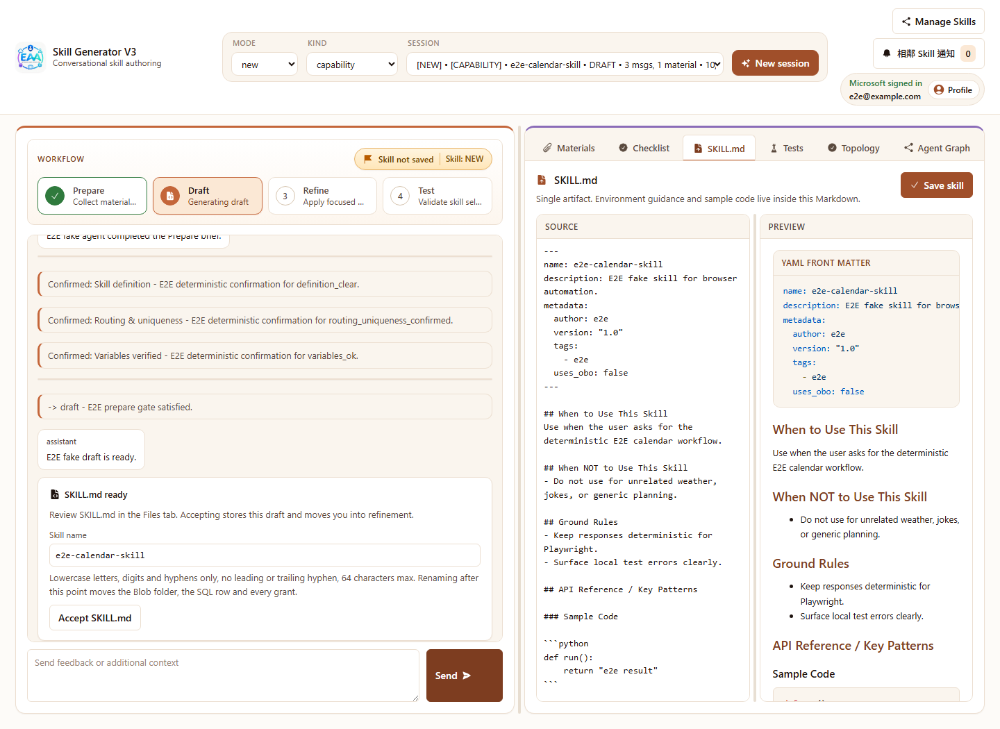

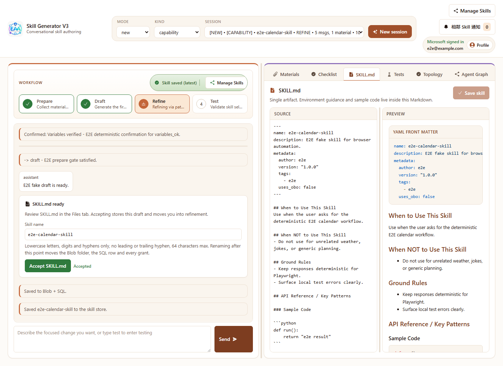

**預期結果：**首次儲存成功後進入 REFINE，正式套件與登錄已寫入知識庫。新 Skill 預設不公開，作者保留使用授權；要分享請另開 Manage Skills。

儲存會先做本機與 EAA lint。error 會擋下，warning 需檢視但不一定阻止儲存；取不到 EAA 判定時也不會放行。**有草稿卡、Preview 或對話進度，都不等於儲存成功。**

手動編輯 Source 後仍要完成 **Save skill** 並核對結果。需要改名時請告訴 Agent 使用改名流程，不要自行改已儲存內容的 frontmatter `name`；改名會搬移套件、登錄與授權，不只是修改標題。

## 7. 精修與 Patch 審閱

1. 在對話說明具體要改的範圍，例如：「缺少必要日期時應回報缺少欄位，不要猜測；其餘行為不變。」
2. 若 Agent 先詢問修正方向，先確認方向，再等待 Patch。
3. 在 **Patch proposed** 卡片展開 **Review diff**，逐項查看新增與刪除。
4. 符合需求時點 **Accept patch**；不接受時點 **Reject**，並補充原因。
5. 接受後檢查卡片狀態、Source／Preview 與儲存結果，確認沒有未處理錯誤。

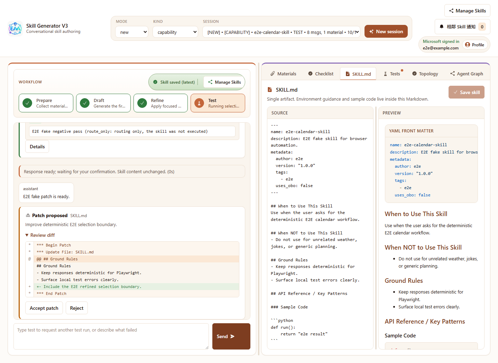

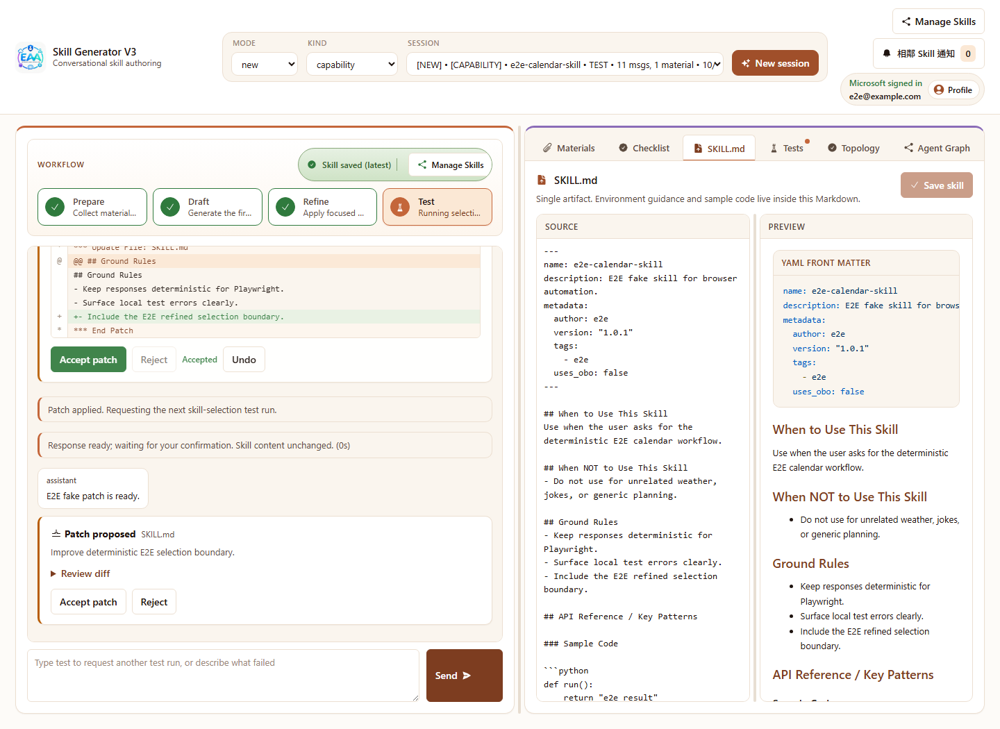

對已綁定的 Skill，接受內容 Patch 會嘗試同步正式套件與登錄；**不是先接受、等到 DONE 才發佈**。若畫面回報同步或 lint 失敗，請先處理，不要把本機已變更誤認為正式版本已更新。

需要撤銷時，可使用卡片上的 **Undo**，再核對內容與同步狀態。這只適用該次 Patch 操作，**不是任意歷史版本的還原介面**。接受後 Agent 可能接續回覆、要求重測或提出下一張卡；每一張新提案都要個別審閱。

沒有實際修改意見或待處理 finding 時，不需要為了推進流程而硬做一次 Patch。

## 8. 設定與執行路由測試

### 編輯正負面樣本

1. 先確認要測試的 Skill 已成功儲存。
2. 開啟 **Tests**。
3. 在 **Positive samples — should route here** 填入應選到本 Skill 的查詢；可用 **+ Add row** 增加不同說法與邊界情境。
4. 在 **Negative samples — should NOT route here** 填入容易混淆、但不應選到本 Skill 的查詢，並核對 **Route to which peer** 與 **Why NOT this skill**。
5. 點選 **Save samples**，選擇此次更新方式。

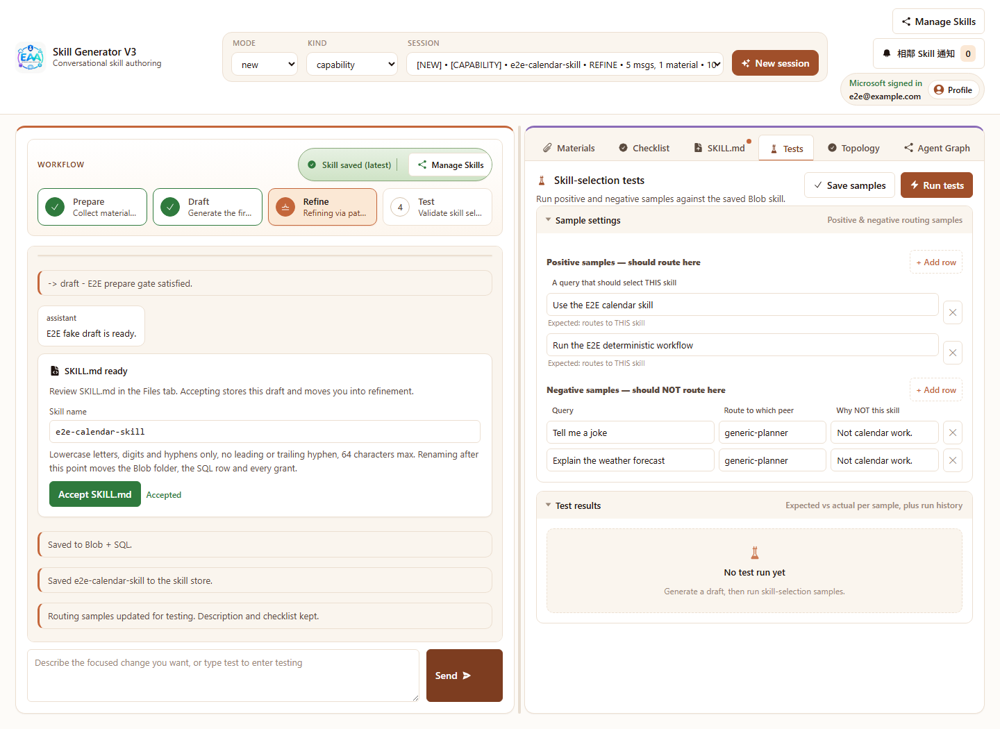

| 選項 | 效果 |
| --- | --- |
| **Just update the samples** | 只更新測試樣本，保留目前 description 與已確認的 Checklist。 |
| **Update & ask the agent to review** | 儲存樣本，並請 Agent 檢視是否需要調整 description 或重新確認關卡。 |
| **Cancel** | 關閉這次儲存確認，不完成此操作。 |

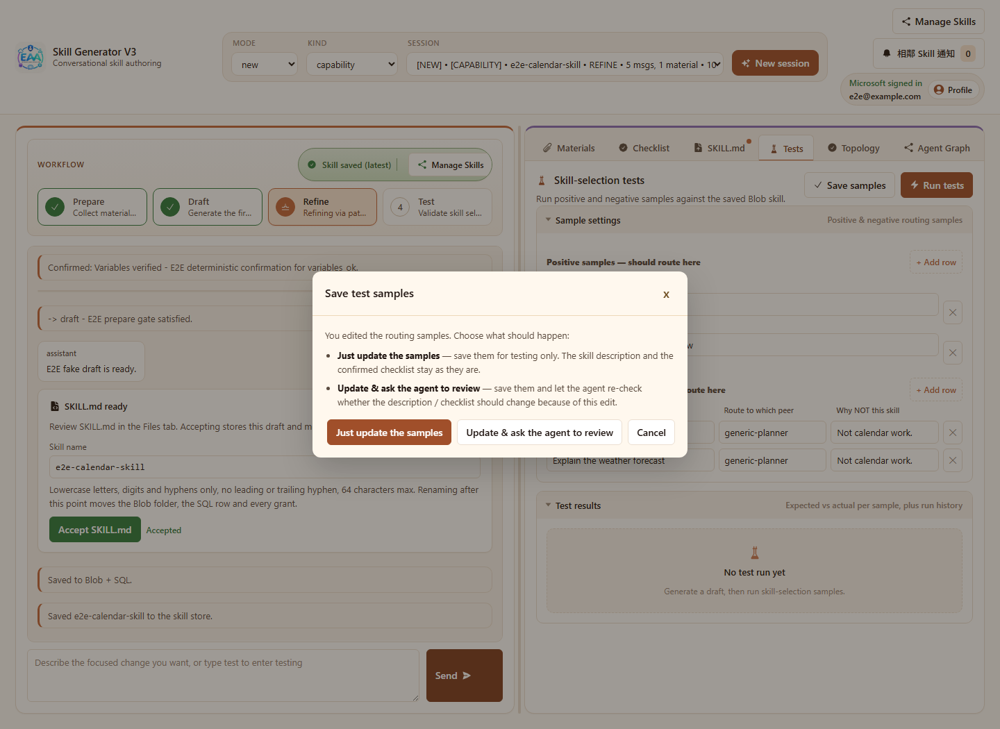

正式樣本應使用使用者真的會問的句子，不要照抄圖中的 E2E 測試指令。日曆範例可用「找出下週二下午三位同事都空閒的半小時」作正面；「替我送出會議邀請」則可檢查是否守住只讀的邊界。

### 執行與判讀

1. 點選 **Run tests**，等待整批結果與 Agent 後續說明。
2. 查看 **Test results** 的執行紀錄、Positive／Negative 比率與每筆 PASS／FAIL。
3. 向下捲動檢查所有樣本；需要時展開明細，不只看總百分比。
4. 若有誤選或漏選，先確認原因，再依 [Patch 審閱流程](#7-精修與-patch-審閱) 修正、儲存並重測。

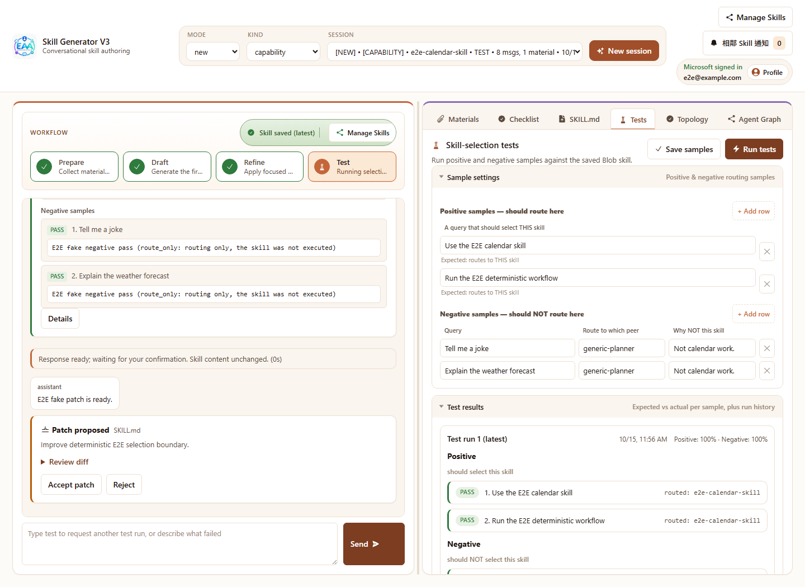

**這是 `route_only` 路由測試，不執行 Skill 的外部業務操作。** 它不會替你驗證日曆 API 是否真的可讀、請假是否真的寫入、程式執行是否正確，或報表是否真的產生。script 的 requested script／參數紀錄也只是 Router 預計執行的內容。

測試針對已儲存的 Skill；本機尚未儲存的修改不應當成受測正式版本。真實路由端點與委派權限須先設定，見 [路由測試設定](02-setup.md#51-路由測試)。

## 9. 完成驗收

1. 確認最新內容已成功儲存，沒有待處理的 lint error、同步錯誤或修改提案。
2. 確認必要的路由測試已完成；未執行的測試要明確列為未驗證。
3. 程式與外部整合另依你的測試環境驗證，尤其是有寫入副作用的操作，不要直接在正式資料上試跑。
4. 在對話告訴 Agent：「目前內容已確認，沒有其他修改；請整理驗收結果與尚未驗證事項，完成此 Skill。」
5. 確認工作進入 DONE，並檢查最後說明的範圍與限制。

**DONE 是對話工作的完成狀態，不是首次儲存時點，也不是正式業務執行成功的保證。** 若沒有路由測試需求，可在 REFINE 驗收完成，但應保留未測試的事實。

## 10. 恢復對話

1. 以原作者帳號登入。
2. 在頁首 **Session** 選單選取原本對話；辨識模式、Kind、標題、階段與更新時間。
3. 等待內容載入，核對綁定的 Skill、草稿、素材、問題卡與目前階段。
4. 在同一段對話接續，不必重新按 New session。

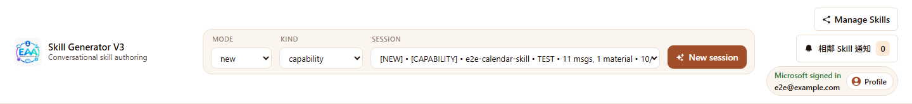

對話區會依保存順序呈現文字、問題與已提交的回答、修改提案及處理結果、儲存結果與測試摘要。已完成的卡片為唯讀，Patch 提案仍可展開查看原始修改；只有尚待處理的卡片可以提交或接受。恢復對話不會重新執行這些操作，也不提供從歷史卡片再次套用或 Undo。

請區分「Patch 已套用至本機」與「已儲存至 Blob + SQL」。同步失敗會保留原因，之後儲存成功另有一筆結果，不會把先前失敗改寫為成功。歷史呈現以實際保存的資訊為準，缺少的問題、選項或提案細節不會補造；畫面歷史也不表示 Agent 每回合都會讀取全部對話。

modify 模式下的 Session 清單會依目前 Skill 篩選，沒看到對話時先檢查 Mode、Skill 與登入帳號。本機模式的對話進度存放在執行 Generator 的電腦，不會因登入相同帳號就自動跨電腦同步。

若正式 Skill 已被其他程序更新，不要直接用恢復的舊草稿覆蓋。遇到版本衝突時，保留需要的差異，重新載入最新 Skill，再進行審閱與修改。

## 11. 修改既有 Skill

1. 將 **Mode** 設為 **modify**。
2. 在 **Skill** 選擇自己建立的 Skill；必要時按旁邊的重新整理按鈕，讀取最新清單。
3. 確認 **Kind** 隨所選 Skill 顯示；修改時不自行變更種類。
4. 在 **Edit** 選擇 **quick edit** 或 **re-plan**。
5. 點選 **New session**，等待載入完成，並再次核對綁定的 Skill 名稱。

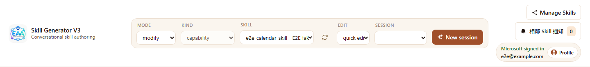

| Edit 選項 | 適合情境 | 起點 |
| --- | --- | --- |
| **quick edit** | 調整少量描述、修正條件、處理既有 finding | 以已儲存內容為基準，從 REFINE 開始。 |
| **re-plan** | 重新定義目標、資料來源、能力範圍或重要輸入 | 載入既有內容，從 PREPARE 重新確認。 |

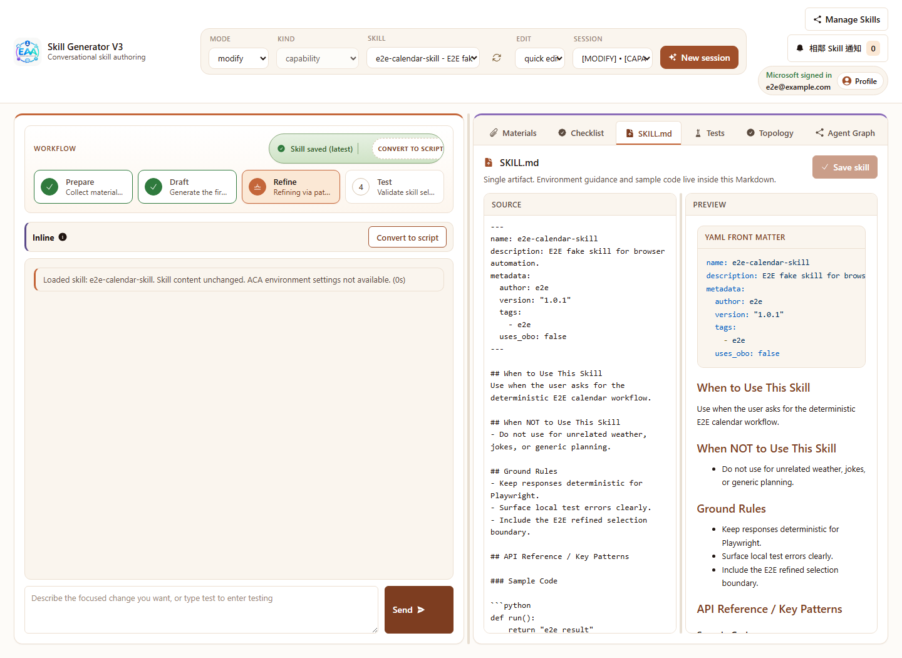

6. 說明具體要改什麼、哪些行為必須保留。
7. 依需要完成確認、審閱 Patch、核對儲存結果，並重跑相關測試。

他人公開或授權給你的 Skill，不因此出現在可修改清單。**建立修改對話、讀取內容或重新查詢環境，不會直接變更 Skill；接受修改或完成儲存才會嘗試寫入。**

## 12. 建立 scenario 型 Skill

scenario 用來描述跨 Skill 的編排與交接；capability 負責可重複使用的獨立能力。不要為了把幾支 API 放一起就任意選 scenario。

1. 選擇 **Mode = new**、**Kind = scenario**，再按 **New session**。
2. 對話會主動說明 **Host Agent** 與 **EAA internal Agent** 的差異及目前設定；目標清楚後，會在確認能力分工前依需求提出有理由的建議，讓你保留、切換或請它協助判斷。預設 Host 不代表你已同意採用。
   - **Host**：宿主解讀 parent、決定下一步、追問與階段接續，讀取子 Skill 契約、組裝輸入並委派；children 仍可全部在 EAA 執行，不需要刻意安排宿主專屬工作。
   - **EAA**：內部 Agent 讀契約、調派子 Skill 並負責階段接續與追問，宿主啟動並轉達問題與結果。選擇須有明確責任理由，例如希望 EAA 持有接續與追問責任，或多個 Host 共用後端編排；真實執行仍需 Mode B／互動 OBO。
   - **選擇依據**：capability 的執行位置不等於編排決策的責任歸屬；不能只因 children 全由 EAA 執行就選 EAA，也不代表 EAA 必然更快、更省或品質更好。你未指定且資訊不足時，對話會先詢問責任歸屬，不會依 children 的執行位置自動選擇；部署條件不明也會先釐清。
   - **對話確認即可切換**：選擇切換後，Agent 直接更新 session，右側選單同步，並自動繼續 PREPARE；不需再按 **Apply owner** 或傳「繼續」。已有草稿時，原問題卡會先說明清稿與重新生成影響，選擇切換即代表同意；未事先說明影響的自由文字要求才補問一次。空白新 scenario 不需要清稿確認。
   - Checklist 的 **Orchestration owner → Apply owner** 保留為手動替代入口。只有 scenario 有此選項；開啟既有技能會保留原 owner，未宣告仍是 Host；已確認的選擇不會每回合重問。
3. 在 **Dependency whitelist (metadata.children)** 選擇流程可能使用的所有子 Skill；需要多個時用 **+ Add skill**。
4. 點選 **Save children**，等待儲存完成；**先宣告依賴，再進行路由與鄰近 Skill 比較**。
5. 提供流程需求並逐項確認。Host 模式確認宿主前置工作、契約指標與能力交接；EAA 模式確認內部 Agent 如何讀契約、調派能力、補問、取得同意與處理不明結果，不需要 Host 逐一串接 children。
6. 審閱草稿並查看 **Topology**，處理未通過項目後再儲存與測試。兩種模式都用技能正文描述流程，不產生固定流程設定檔。另須核對正文責任：EAA owner 指示 EAA 編排、Host 啟動並轉交問題與結果；Host owner 指示 Host 編排與委派，不得仍要求 Host 不參與階段接續。

**切換已有技能的 owner**：可直接在對話選擇，或在 MODIFY 開啟 scenario 後改選 owner 並按 Apply owner。
兩種入口都必須先說明並取得同意，才會清除草稿、待接受 patch、失效測試與確認，回到 PREPARE 重新確認並生成；
對話卡已說明影響並獲同意時，不會再要求 UI 確認。手動入口維持原本的確認視窗。
取消就維持原狀；確認也只改本地 session，遠端直到新稿被接受且成功儲存才改變。
原正文會暫留為唯讀業務規則來源；不可在編輯器直接改 owner 來略過這個流程。
新建對話若已有草稿，也採同樣保護。

EAA 模式的真實執行需要 Mode B／互動 OBO，不支援 app-only Routine 或靜態 fallback；
部署驗收見 [EAA MCP 設定](02-setup.md#26-eaa-mcp)。

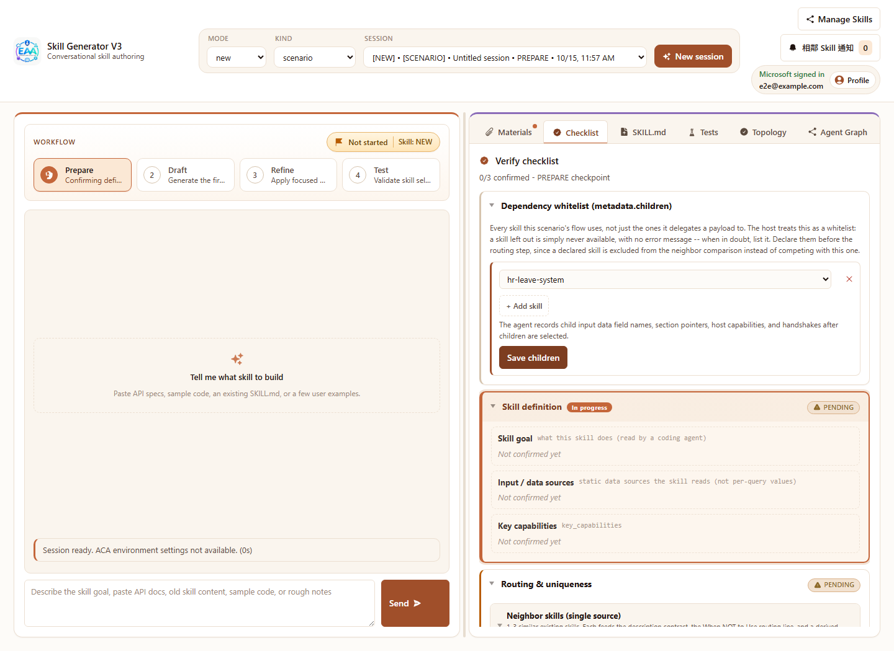

**白名單不是執行順序；不只列委派 payload 的 Skill，也要列必要的直接依賴。** 漏列會讓所選執行者無法使用該能力；不要期待 Router 清單自動補齊所有依賴。子 Skill 也不是路由競爭者，不要為了「避免重疊」把必要子 Skill 排除。EAA 的 children 限可執行 inline／script，不支援巢狀 scenario。

scenario 路由測試會呈現分層結果：

| 層次 | 主要檢查 | 不代表 |
| --- | --- | --- |
| **L1** | 靜態拓樸與宣告結構 | 外部系統已執行成功。 |
| **L2** | Host：parent 不應出現在 capability 路由紀錄；EAA：parent 應被解析並出現在紀錄 | 每個業務分支都已執行。 |
| **L3** | Host：路由紀錄中的子 Skill 可達性；EAA：顯示未驗證 child 執行 | 逐一完成子 Skill 的真實業務操作。 |

逐項查看結果中的未驗證說明，不要把分層通過當成完整端對端業務驗收。scenario 不支援 script 形式或附帶資產。

## 13. 使用 script 形式與轉換

### 新建時採用 script

1. 建立 capability 對話，在 Materials 提供**唯一一份 code 素材**。
2. 確認它涵蓋此 Skill 所有操作，且由你實際驗證過；不要把片段程式宣稱為完整實作。
3. 確認目標 EAA 已啟用 script 功能，且 ACA 查詢成功；管理員設定見 [script 選用功能](02-setup.md#52-aca-環境變數查詢與-script-型-skill)。
4. 在 Materials／Checklist 的 **Output form** 檢查目前判斷與未滿足條件；需要 inline 時可明確選擇。
5. 如果素材邊界不符合平台要求，先確認是否同意調整，再審閱素材 Patch；接受後仍需實際執行確認，**edited by agent · not run 不表示已測試**。
6. 進 DRAFT 後，在 **SKILL.md** 分頁確認 Markdown 與 `scripts/<name>.py` 兩份檔案。

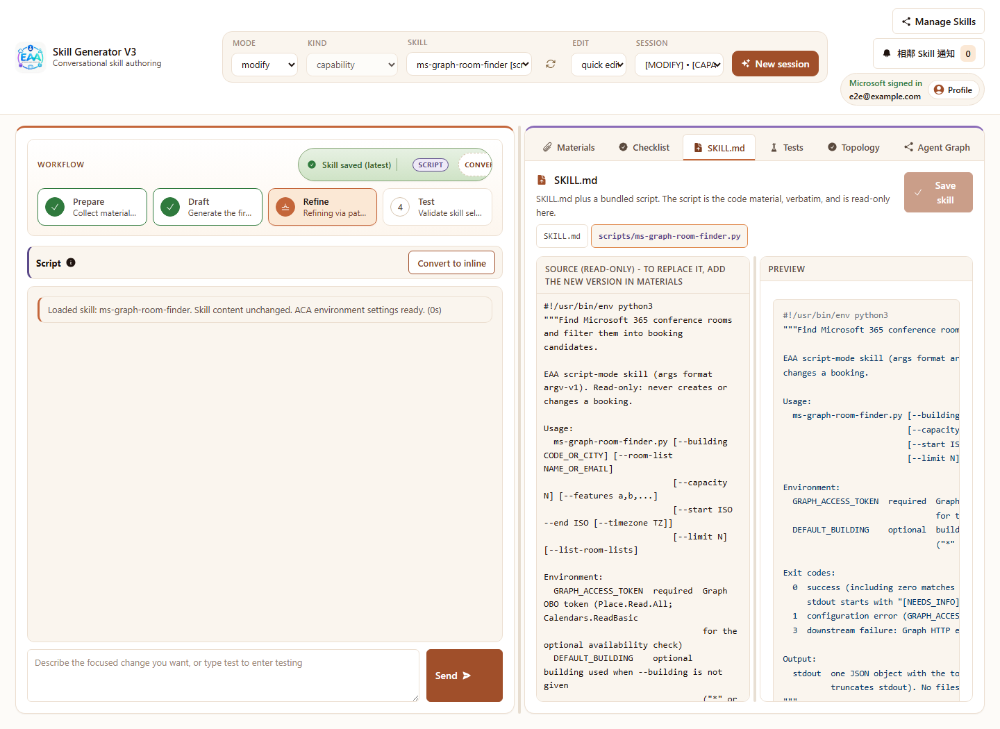

script 分頁為唯讀。要換程式請回 Materials 提供新版本；不要嘗試在此編輯器直接改 script。Agent 只在允許範圍內調整參數、stdout／stderr、exit code 等邊界，不以重新生成業務邏輯取代你提供的程式。

script 每次儲存都會重新檢查旗標與 lint；路由測試不執行 script。缺少環境查詢或旗標未開啟時，不要僅靠「請產生 script」強制跳過條件。

### 既有 Skill 形式轉換

1. 在既有 capability 的 modify 對話，查看上方形式卡的 **Convert to script** 或 **Convert to inline**；也可從 Workflow／Checklist 的對應入口操作。
2. 閱讀不可用原因與轉換條件。inline → script 需要剛好一個可解析的 Python 區塊、沒有附帶資產、尚無 Patch，且 EAA 旗標允許。
3. 轉換後審閱檔案，再請 Agent 依新形式修正說明與章節。
4. 審閱後續 Patch，完成儲存並核對 lint 結果；變更過的程式仍由作者驗證。

轉換只搬移程式碼，本身不表示已通過檢查或寫入正式版本；**接受後續內容 Patch 則可能開始同步正式版本**。script → inline 儲存成功時會移除正式套件中的原 script 檔案。

## 14. 附帶 Skill 資產

適用於 inline capability。要發佈範本、CSS、HTML 或查表資料時，使用 **Skill assets**，而不是把檔案當成一般背景素材。

1. 開啟 **Materials**，找到 **Skill assets — published with the skill when you save**。
2. 選擇 `assets/` 或 `references/` 目錄。
3. 點選 **Upload files…**，選取 UTF-8 文字檔。
4. 確認清單的完整路徑、字元數與雜湊；可用 **Replace** 換檔，或叉號從目前對話移除。
5. 請 Agent 更新 `## Skill Resources`，以完整路徑列出每份檔案，說明何時讀取、是否必讀及如何使用。
6. 檢查內容後儲存 Skill，才會將資產發佈；刪除資產同樣要完成儲存才會反映到正式套件。

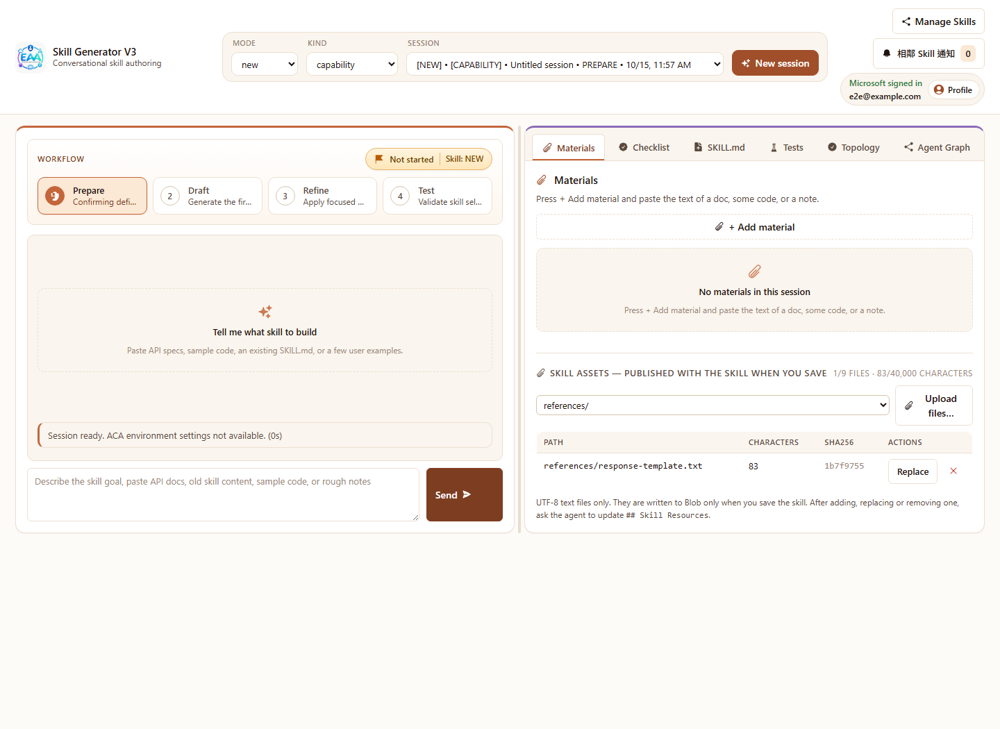

資產原封不動發佈，Agent 不會替你改檔案內容；修改後的版本由你上傳。scenario 與 script 形式不可附帶資產。若檔案被拒絕，依畫面檢查編碼、類型、路徑與大小限制，不要把未附加成功的檔案寫成已發佈。

## 15. 輔助視圖

### Topology

1. 開啟 **Topology**，查看目前內容的結構檢查。
2. 找出 FAIL／warning，閱讀規則與原因；scenario 特別要檢查 children、子 Skill 存在性與章節指標。
3. 修正對應內容後再次查看結果；清單較長時請向下捲動。

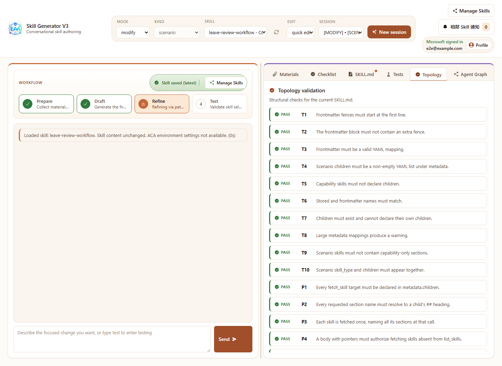

**Topology 通過只代表這些結構規則通過**，不能取代儲存 lint、路由測試或實際程式測試。

### Agent Graph

1. 開啟 **Agent Graph**，查看階段與允許的轉移關係。
2. 點選節點閱讀該階段的提示、資料與說明。
3. 圖表不在合適範圍時先按 **Fit graph**；需要較大畫面時再按 **Fullscreen**，用 `Esc` 返回。

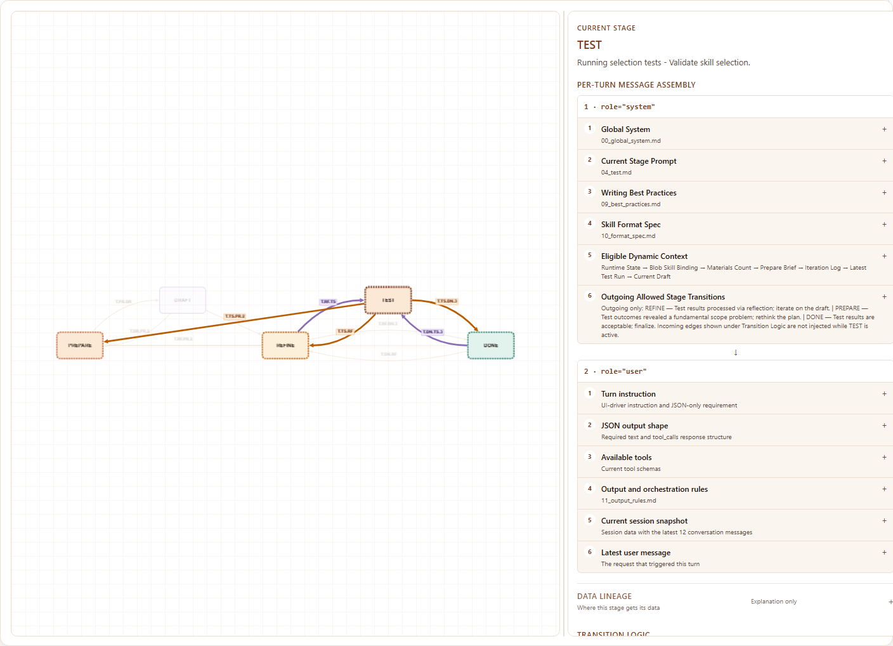

Agent Graph 是理解運作方式的輔助視圖，不是手動強制轉移階段的控制台。一般作者不需要開發者用的 Inspect 視圖，也不需要複製其中提示詞才能操作。

## 16. 分享與相鄰 Skill 通知

### 分享、公開與刪除

儲存後點選頁首或 Skill 狀態列的 **Manage Skills**，選取 Skill，再設定 Public、User／Group 授權或查看刪除條件。完整步驟與截圖見 [Manage Skills 使用者指南](06-manage-skills-guide.md)，此處不重複管理操作。

### 處理相鄰 Skill 關係

若 Agent 發現路由邊界與其他 Skill 可能混淆，先確認差異與是否需調整。自己的鄰近 Skill 可依權限審閱修改；他人的 Skill 不會因你接受來源提案就被直接改寫。

| 你的角色 | 操作與預期 |
| --- | --- |
| 提出者 | 確認是否通知其他作者；**來源 Skill 儲存成功後**才送出關係通知。排入待送不等於送達；看到「通知尚未送達」時，處理原因後可再次儲存重試。 |
| 收件建立者 | 點選頁首 **相鄰 Skill 通知** 或提示橫幅，查看目標、提出者與相關來源；選 **開啟審閱** 進入 Quick Edit，或 **略過並結案**。 |

通知只表示值得審閱的相鄰關係，**不是已確認衝突、現成 Patch 或自動修改**。開啟審閱時依最新內容比較，需要修改才提出 Patch 供你確認。

## 17. 常見問題

| 畫面或情況 | 建議處理 |
| --- | --- |
| 一直停在 PREPARE | 查看未確認關卡與問題卡，補齊資料、邊界、輸入；scenario 先儲存 children。不要只要求跳階段。 |
| 已有素材，但沒有草稿 | 確認素材已附加、需求已送出、確認問題已提交；上傳或貼上文字不一定會自動開始完整生成。 |
| 顯示內容未修改／等待確認 | 檢查是否有初稿、問題或 Patch 卡；Agent 提案不代表已接受。 |
| 儲存被 lint 擋下 | 閱讀具體 finding，請 Agent 修正相應內容，再審閱並重試；不要刪除規則或把 warning／error 全部當成可略過。 |
| EAA lint 無回應／HTTP 503 | 未取得判定不能儲存；請管理員檢查 MCP 與驗證設定。若訊息是備份失敗，另檢查歷史容器。 |
| HTTP 409 或版本衝突 | 正式內容可能已被更新；保留差異，重新載入最新 Skill，再審閱修改，不要強制覆蓋。 |
| Tests 無法執行 | 先確認 Skill 已儲存、路由端點已設定、登入有效且有使用權；測試不靠建立者身分繞過 runtime 授權。 |
| 測試 HTTP 502／token 被拒 | 檢查登入與 runtime 設定，請管理員確認 audience 與 EAA log；不要把它判成某筆查詢的路由錯誤。 |
| 測試 100%，實際執行仍失敗 | 路由測試不執行業務程式；另驗證輸入、OBO、API 權限、外部服務與實際程式結果。 |
| 找不到可修改的 Skill | 核對帳號、作者身分、Mode 與清單更新；讀取授權或 Public 不提供修改權。 |
| New session 載入後的 Skill 不是預期目標 | 先核對綁定名稱，不送出修改或儲存；重新整理頁面後重新選擇 Mode、Skill 與 Edit，再建立對話。 |
| script 無法選取／儲存 | 檢查唯一 code 素材、操作完整性、Output form 條件、ACA 查詢與 EAA 旗標；程式本身也要符合平台邊界規範。 |
| 資產不能儲存 | 確認類型支援資產、檔案已成功附加，且 Skill Resources 完整列出路徑，沒有引用未附加檔案。 |
| 刪除後還看得到對話 | 對話保留是預期行為；Skill deleted 的綁定不能再直接儲存到已刪除 Skill。 |

---

**維護註記（非使用步驟）：**圖片由 `tests/e2e/generator-guide.spec.ts` 產生，預設略過。更新前先備份並驗證實際對話目錄，確認 E2E session、Skill 與 auth 全部使用隔離本機儲存，再設定 `SGV2_GENERATOR_GUIDE_SCREENSHOTS=1` 執行 `npx playwright test tests/e2e/generator-guide.spec.ts --project=chromium`。Playwright 自行啟動測試服務，不要對正式服務呼叫 reset。scenario 與 script 使用獨立本機範例；圖片是 UI 操作示範，不作為正式雲端整合驗證。